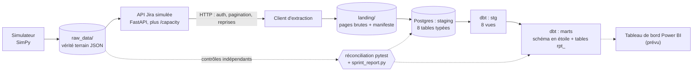

# Agile Analytics Pipeline (AAP)

[English version](README.md)

Un pipeline de données qui croise les données de livraison Jira avec les données de capacité de plusieurs équipes, et répond à six questions sur ce que chaque équipe livre au regard des personnes dont elle disposait réellement.

## En bref

- **Problème.** Jira produit ses rapports équipe par équipe et ne connaît pas la capacité des équipes. Une vue transverse de la livraison rapportée à la capacité demande un pipeline dédié.
- **Ce qu'il fait.** Il extrait des données au format Jira et des données de capacité pour trois équipes, sur 12 sprints chacune. Il les charge dans un entrepôt Postgres, modélise un schéma en étoile avec dbt et répond à six questions métier sous forme de tables prêtes à lire.
- **Stack.** Python 3.13, SimPy, FastAPI, httpx, PostgreSQL 18 sous Docker, dbt Core 1.12, pytest, uv. Tableau de bord Power BI prévu.
- **Preuves.** Les métriques de sprint sont égales à un corrigé indépendant (`simulator/sprint_report.py`) sur les 36 sprints. Le staging est égal, ligne à ligne, à la vérité terrain du simulateur. 140 tests pytest, 229 tests de données dbt et 30 tests de hooks passent. 34 tests de sabotage montrent que les contrôles savent échouer.
- **Données.** Simulées, et servies par une imitation du contrat REST réel de Jira ([pourquoi](#une-note-sur-les-données)).
- **Essayer.** [Démarrage rapide](#démarrage-rapide) : une seule commande construit l'entrepôt depuis une base vide, en environ 25 secondes depuis un clone une fois les téléchargements faits.

## Pourquoi ce projet existe

### Le problème

Les rapports intégrés de Jira (vélocité, rapport de sprint, burndown) se limitent à un seul tableau. Une vue portefeuille transverse aux équipes nécessite des extensions payantes. Jira n'a pas non plus de notion de capacité : il ignore combien de personnes une équipe avait dans un sprint, et combien de jours elles ont été absentes. Deux équipes de même vélocité ne se valent pas si l'une d'elles a perdu un cinquième de son temps en congés.

Ce projet construit la couche manquante. Il réunit dans un même entrepôt les données de livraison issues de Jira et les données de capacité (effectif et jours d'absence par équipe et par sprint), pour toutes les équipes.

### Les objectifs

1. **Un livrable de stage.** C'est le livrable data engineering d'un stage chez ISICOD.
2. **Un projet de portfolio.** Il montre, de bout en bout, le travail d'un data engineer ou analytics engineer junior : consommer un vrai contrat d'API, charger les données de façon sûre, les modéliser, définir les métriques avec précision et prouver que les chiffres sont justes. Chaque choix de conception est consigné avec les options écartées ([journal des décisions](docs/decisions.md)).

### Une note sur les données

**Les données sont simulées.** Aucune donnée Jira réelle d'entreprise n'était disponible. Une instance Jira publique a été envisagée puis écartée : ce sont des outils de suivi de bugs open source, sans sprints ni équipes stables ([D-001](docs/decisions.md#d-001-synthetic-data-from-a-simulator-not-a-public-jira-instance)).

**Le pipeline est construit contre une API simulée qui reproduit le contrat REST réel de Jira** (pagination, champs personnalisés, formats d'horodatage), **parce que l'API Jira réelle ne permet pas d'antidater l'historique.** Jira Cloud horodate chaque création et chaque changement de statut au moment de l'appel d'API. On ne peut donc pas charger des mois d'historique de sprints dans un vrai site Jira, alors que les questions sur les sprints et sur le temps passé par statut en dépendent.

Une simulation à événements discrets (SimPy) génère donc trois équipes aux façons de travailler différentes. Un serveur FastAPI sert ensuite ces données dans les formats de réponse de Jira : pagination par jeton pour la recherche, par décalage ailleurs, story points dans `customfield_10016`, deux styles d'horodatage. [`docs/mock-api.md`](docs/mock-api.md) indique quelles parties du contrat ont été confirmées dans les spécifications publiées par Atlassian, et lesquelles sont des hypothèses. Le client d'extraction est écrit comme il le serait pour un vrai site Jira.

La capacité n'a pas de contrat Jira à imiter. Elle vient donc d'un petit endpoint `/capacity` conçu par nos soins, séparé des endpoints au format Jira ([D-008](docs/decisions.md#d-008-capacity-through-its-own-small-rest-endpoint)).

## Architecture



Les flèches pleines représentent le flux de données. Les contrôles en pointillés lisent `raw_data/` directement, sans passer par l'API ni par le code du pipeline, et le comparent à l'entrepôt.

| Étape | Rôle | Technologie | Code | Documentation |
|---|---|---|---|---|
| Simulation | Génère la vérité terrain : 3 équipes, 12 utilisateurs, 36 sprints, 530 tickets, 1 488 changements de statut, 36 lignes de capacité (graine 22) | Python, SimPy, numpy | [`simulator/`](simulator/), [`scripts/generate_raw_data.py`](scripts/generate_raw_data.py) | [domain-model.md](docs/domain-model.md) |
| API Jira simulée | Sert la vérité terrain au format REST de Jira, plus `/capacity` | FastAPI, uvicorn | [`mock_api/`](mock_api/) | [mock-api.md](docs/mock-api.md) |
| Extraction | Parcourt toutes les pages de chaque endpoint et dépose chaque réponse telle quelle, avec un manifeste | Python, httpx | [`ingestion/client.py`](ingestion/client.py), [`ingestion/extract.py`](ingestion/extract.py) | [01-extraction.md](docs/etl/01-extraction.md) |
| Staging | Transforme les pages déposées en 8 tables typées, en une seule transaction | Python, psycopg 3, PostgreSQL 18 sous Docker | [`ingestion/parse.py`](ingestion/parse.py), [`ingestion/load_staging.py`](ingestion/load_staging.py), [`warehouse/`](warehouse/docker-compose.yml) | [02-staging.md](docs/etl/02-staging.md) |
| Schéma en étoile dbt | Renommage dans les vues `stg`, puis 4 dimensions et 3 faits dans `marts` | dbt Core 1.12, dbt-postgres 1.11 | [`dbt/models/staging/`](dbt/models/staging/), [`dbt/models/marts/`](dbt/models/marts/) | [03-dbt-star-schema.md](docs/etl/03-dbt-star-schema.md) |
| Métriques | Métriques de sprint et les six questions métier, en 10 tables `rpt_` | dbt (SQL) | [`dbt/models/metrics/`](dbt/models/metrics/) | [04-metrics.md](docs/etl/04-metrics.md), [metrics/](docs/metrics/README.md) |
| Exécution en une commande | Lance toutes les étapes depuis une base vide, démarre et arrête l'API simulée, et vérifie après chaque étape que rien n'a été perdu | Python | [`pipeline/`](pipeline/) | [05-pipeline.md](docs/etl/05-pipeline.md) |
| Tableau de bord | Rapport Power BI sur les tables `rpt_` | Power BI | [`dashboard/`](dashboard/) (vide) | prévu, pas commencé |

## Les six questions métier

Résultats sur le jeu de données livré (graine 22). Chaque modèle est une table du schéma `marts`.

| # | Question | Résultat principal | Modèle | Page |
|---|---|---|---|---|
| 1 | Combien de story points chaque équipe termine-t-elle par sprint, et quelle est la tendance ? | Phoenix 42,4, Nomad 18,9, Atlas 11,8 points par sprint. 343 points (28,1 % de tout le travail terminé) sont finis après la fin de leur sprint et ne comptent dans aucun sprint. | `rpt_q1_velocity` | [q1](docs/metrics/q1-velocity.md) |
| 2 | Combien chaque équipe livre-t-elle pour la capacité dont elle disposait réellement ? | 0,87 ; 0,53 et 0,41 point par jour-personne disponible (Phoenix, Nomad, Atlas). L'écart reflète surtout le nombre d'heures que coûte un point dans chaque équipe. | `rpt_q2_velocity_vs_capacity` | [q2](docs/metrics/q2-velocity-vs-capacity.md) |
| 3 | À quelle fréquence le travail est-il terminé après son échéance, par type de ticket et par équipe ? | Tickets résolus seulement : Story 20,4 %, Task 28,9 %, Bug 38,8 %. 3 tickets sont ouverts et en retard à la fin des données. Le travail ajouté en cours de sprint est bien plus souvent en retard que le travail engagé. | `rpt_q3_breach_rate`, `rpt_q3_deadline_outcomes` | [q3](docs/metrics/q3-breach-rate.md) |
| 4 | Combien de temps le travail reste-t-il dans chaque statut ? | Médiane de 74,8 h en In Progress, 4,6 h en Code Review, 19,0 h en QA (heures calendaires, toutes équipes). To Do (912,5 h) est surtout de l'attente dans le backlog. | `rpt_q4_time_in_status`, `rpt_q4_status_stays` | [q4](docs/metrics/q4-time-per-status.md) |
| 5 | Combien de Bugs chaque équipe crée-t-elle par Story, au fil du temps ? | Nomad 0,79, Phoenix 0,68, Atlas 0,25. | `rpt_q5_bug_to_story_ratio` | [q5](docs/metrics/q5-bug-to-story.md) |
| 6 | Comment les équipes se comparent-elles côte à côte, une fois leur taille prise en compte ? | Phoenix livre le plus par jour-personne mais tient le moins souvent son engagement (5 sprints sur 12). Atlas le tient le plus souvent (9 sur 12) mais a le taux de dépassement le plus élevé (33,3 %). Nomad perd le plus de temps en congés (10,3 %). | `rpt_q6_team_portfolio` | [q6](docs/metrics/q6-portfolio.md) |

Toutes reposent sur `rpt_sprint_metrics` : les story points engagés, ajoutés en cours de sprint et terminés, par sprint, comparés sur des horodatages exacts et jamais sur des jours calendaires ([04-metrics.md](docs/etl/04-metrics.md)). L'index de toutes les pages de métriques, avec les limites qu'elles partagent, est [docs/metrics/](docs/metrics/README.md).

## Pratiques d'ingénierie

Ce qui rend les chiffres fiables, avec la preuve de chaque point.

- **Vérification indépendante contre la vérité terrain.** Les contrôles ne passent jamais par le code du pipeline lui-même.
  - Les 8 tables de staging sont égales à `raw_data/` ligne à ligne. Le test lit le JSON avec la bibliothèque standard, n'importe rien de `mock_api/` ni du parseur, et vérifie qu'il ne le fait pas ([02-staging.md](docs/etl/02-staging.md#reconciliation-with-raw_data-step-23)).
  - Les métriques de sprint sont égales au corrigé du simulateur sur les 36 sprints, pour les six valeurs qu'il produit ([04-metrics.md](docs/etl/04-metrics.md#reconciliation-with-the-answer-key-pytest)).
  - Les questions 1 à 5 sont recalculées en Python pur à partir de `raw_data/`, et la question 6 doit leur être égale, équipe par équipe ([`tests/test_metrics.py`](tests/test_metrics.py)).
  - Un test prouve qu'aucun horodatage brut ne tombe dans la première milliseconde après une borne de sprint : l'égalité exacte n'est pas due au hasard ([D-035](docs/decisions.md#d-035-the-millisecond-floor-is-checked-at-sprint-boundaries-not-tolerated)).
- **Tests de sabotage.** 34 fonctions `test_sabotage_*` cassent volontairement une chose et vérifient que le bon contrôle échoue. Exemples : comparer des jours calendaires au lieu d'horodatages modifie 17 des 36 sprints. Une comparaison d'échéance inversée transforme 20,4 % en 79,6 %. Supprimer une page déposée fait échouer les comptages. Sans les hooks, 18 des 28 cas de test des hooks échouent ([workflow.md](docs/workflow.md#testing-the-hooks)).
- **Chargement idempotent et atomique.**
  - L'extraction écrit dans un répertoire temporaire et ne remplace `landing/` qu'après une exécution réussie. Une réexécution produit des fichiers identiques octet pour octet ([01-extraction.md](docs/etl/01-extraction.md)).
  - Le staging se charge en une seule transaction (`TRUNCATE` puis `COPY`). Une exécution qui échoue laisse les lignes précédentes exactement telles quelles, et les vues dbt sur le staging survivent à un rechargement. Des tests couvrent les deux ([D-022](docs/decisions.md#d-022-staging-reloads-by-truncate-and-copy-drop-and-recreate-only-on---rebuild)).
- **Schéma en étoile au grain déclaré.** 4 dimensions (équipe, utilisateur, sprint, ticket) et 3 faits (transition de statut, appartenance à un sprint, capacité par équipe et par sprint), sur des clés naturelles ([03-dbt-star-schema.md](docs/etl/03-dbt-star-schema.md#schema-or-contract)).
- **Tests de données dans dbt.** 229 tests de données : unicité, non-nullité, relations, valeurs acceptées, nombres de lignes, et 12 tests singuliers. Par exemple : chaque transition tombe dans exactement une fenêtre de sprint, et chaque agrégat des taux de dépassement est égal à la somme de ses parties ([`dbt/tests/`](dbt/tests/)).
- **Contrôles d'exhaustivité à l'exécution.** Distincts des tests : après chaque étape d'une exécution réelle, [`pipeline/completeness.py`](pipeline/completeness.py) compare les nombres d'enregistrements avec l'étape précédente (manifeste, fichiers déposés, staging, marts, tables `rpt_`). Une ligne perdue arrête l'exécution avec le code 3 et un message qui nomme l'étape et les deux nombres ([D-044](docs/decisions.md#d-044-the-completeness-check-is-its-own-module-and-compares-counts-between-adjacent-stages)).
- **Hooks git.** `commit-msg` impose les Conventional Commits. `pre-commit` refuse les commits sur `main`, ainsi que les modifications de code sous `ingestion/`, `pipeline/`, `warehouse/` ou `dbt/` sans modification sous `docs/`. [`scripts/test_hooks.sh`](scripts/test_hooks.sh) exécute 30 cas dans un dépôt jetable ([workflow.md](docs/workflow.md#hooks)).
- **Journal des décisions.** 48 décisions consignées (D-001 à D-048), chacune avec son contexte, les options envisagées et la raison de leur rejet ([decisions.md](docs/decisions.md)).
- **Aucun secret dans le dépôt.** Tous les identifiants viennent de l'environnement, via `--env-file .env`. Seul [`.env.example`](.env.example), avec des valeurs factices, est versionné.

**Nombre de tests** (exécutés le 2026-11-06) : `pytest` 140 réussis, 0 ignoré (extraction 18, staging 33, réconciliation 10, dbt 19, métriques 26, vérification de l'API simulée 4, pipeline 30), dans l'ordre normal comme dans l'ordre inverse. `dbt build` PASS=254 (8 vues, 17 tables, 229 tests de données). Tests des hooks : 30 réussis. Les deux scripts de vérification de l'API simulée couvrent ses 48 affirmations documentées ([mock-api.md](docs/mock-api.md#7-verification-status)).

## Compétences démontrées

| Compétence | Où dans le dépôt |
|---|---|
| Consommation d'API : authentification Bearer, pagination par jeton et par décalage, reprises sur les seules erreurs transitoires | [`ingestion/client.py`](ingestion/client.py), [01-extraction.md](docs/etl/01-extraction.md) |
| Conception d'API : imitation d'un vrai contrat REST, plus un endpoint conçu par nos soins | [`mock_api/`](mock_api/), [mock-api.md](docs/mock-api.md) |
| Lecture d'un vrai contrat : champs personnalisés, deux formats d'horodatage, table fixe des statuts | [`ingestion/parse.py`](ingestion/parse.py), [02-staging.md](docs/etl/02-staging.md) |
| ETL avec chargement idempotent et transactionnel | [`ingestion/extract.py`](ingestion/extract.py), [`ingestion/load_staging.py`](ingestion/load_staging.py) |
| Modélisation de données : schéma en étoile, grain, clés naturelles | [`dbt/models/marts/`](dbt/models/marts/), [03-dbt-star-schema.md](docs/etl/03-dbt-star-schema.md) |
| SQL et dbt : fonctions de fenêtrage, `group by cube`, percentiles, tests génériques personnalisés | [`dbt/models/metrics/`](dbt/models/metrics/), [`dbt/tests/generic/`](dbt/tests/generic/) |
| Définition de métriques : règles exactes, hypothèses et limites explicites | [docs/metrics/](docs/metrics/README.md) |
| Tests de qualité des données et réconciliation | [`tests/`](tests/), [`dbt/tests/`](dbt/tests/) |
| Docker : image Postgres épinglée, contrôle de santé, volume nommé | [`warehouse/docker-compose.yml`](warehouse/docker-compose.yml) |
| Simulation à événements discrets, calibrée et contrôlée sur des graines réservées | [`simulator/`](simulator/), [domain-model.md](docs/domain-model.md#calibration-seed-set-decision) |
| Outillage Python : uv, pytest, dépendances verrouillées | [`pyproject.toml`](pyproject.toml), [`uv.lock`](uv.lock) |
| Automatisation du workflow git | [`.githooks/`](.githooks/), [workflow.md](docs/workflow.md) |
| Documentation et registre des décisions | [`docs/`](docs/), [decisions.md](docs/decisions.md) |

## Démarrage rapide

**Prérequis :** Linux ou WSL2 Ubuntu, [Docker](https://docs.docker.com/engine/install/) avec Compose, et [uv](https://docs.astral.sh/uv/) (il installe Python 3.13 si besoin). Les ports 5433 (Postgres) et 8000 (API simulée) doivent être libres.

Toutes les commandes s'exécutent depuis la racine du dépôt.

```bash
# 1. Cloner, configurer, installer
git clone https://github.com/YassineBelhamadia/Agile-Analytics-Pipeline.git
cd Agile-Analytics-Pipeline
cp .env.example .env      # puis remplacer les deux valeurs factices par des valeurs locales quelconques
uv sync

# 2. Générer la vérité terrain simulée (avec graine fixe : les mêmes fichiers à chaque exécution)
uv run python scripts/generate_raw_data.py

# 3. Démarrer Postgres et vérifier la connexion
docker compose --env-file .env -f warehouse/docker-compose.yml up -d --wait
uv run --env-file .env python scripts/check_warehouse.py

# 4. Lancer tout le pipeline : extraire, charger le staging, construire et tester les modèles dbt.
#    Il démarre et arrête lui-même l'API simulée.
uv run --env-file .env python -m pipeline.run

# 5. Lancer toute la suite de tests (les tests Postgres utilisent leurs propres schémas et bases)
uv run --env-file .env python -m pytest -rs
```

Codes de sortie : 0 succès, 1 une étape a échoué, 2 un prérequis manque et rien n'a été écrit, 3 un contrôle d'exhaustivité a échoué, 130 interruption par Ctrl-C, 143 arrêt par SIGTERM. L'exécution affiche l'hôte, le port et la base qu'elle va modifier avant d'écrire quoi que ce soit. Le [guide d'exécution à partir de zéro](docs/clean-run.md) (en anglais) détaille tout le parcours, et [05-pipeline.md](docs/etl/05-pipeline.md#schema-or-contract) indique ce que laisse une exécution en échec.

Pour un contrôle rapide sans base de données, `uv run python -m pytest -m "not postgres"` lance 57 tests en environ 25 secondes. Cela ne remplace pas la suite complète.

**Durée.** Mesurée depuis un clone neuf et une base de données vide, avec l'image Docker et le cache uv déjà téléchargés : les étapes 1 à 4 prennent environ 25 secondes (dont environ 13 pour `dbt build`). La suite de tests a pris 5 min 39 s, mesurée après l'étape 5.2 sur la machine de développement du projet (16 cœurs logiques, 15 Go de mémoire, WSL2). Ces durées dépendent de la machine. Une première exécution télécharge en plus l'image Postgres et les paquets Python.

<details>
<summary>À quoi ressemble une exécution réussie</summary>

- `generate_raw_data.py` se termine par `'teams': 3, 'users': 12, 'sprints': 36, 'issues': 530, 'status_transitions': 1488, 'sprint_issue_memberships': 320, 'capacities': 36`.
- `pipeline.run` commence par une ligne `Target database:`, se termine avec le code 0 et affiche les secondes par étape et les nombres par couche :
  - `landing/` contient 578 pages (dont 530 de changelogs) plus `manifest.json`.
  - `staging` contient 3 équipes, 12 utilisateurs, 3 tableaux, 36 sprints, 36 lignes de capacité, 530 tickets, 1 488 transitions de statut et 320 appartenances à un sprint.
  - `dbt build`, à l'intérieur, se termine par `PASS=254 WARN=0 ERROR=0`.
- `pytest -rs` se termine par `140 passed`, sans aucun test ignoré.

</details>

<details>
<summary>Consulter un résultat, arrêter, et autres contrôles</summary>

Interroger la table portefeuille (l'utilisateur et la base sont les valeurs par défaut de `.env.example`) :

```bash
docker compose --env-file .env -f warehouse/docker-compose.yml exec postgres \
  psql -U aap -d aap_warehouse -c "select team_name, round(velocity_per_sprint, 1) as velocity, round(points_per_person_day::numeric, 2) as points_per_person_day, round(100 * hit_rate, 1) as hit_pct, round(100 * breach_rate_resolved, 1) as breach_pct from marts.rpt_q6_team_portfolio order by team_id"
```

```
 team_name | velocity | points_per_person_day | hit_pct | breach_pct
-----------+----------+-----------------------+---------+------------
 Phoenix   |     42.4 |                  0.87 |    41.7 |       24.1
 Nomad     |     18.9 |                  0.53 |    50.0 |       30.2
 Atlas     |     11.8 |                  0.41 |    75.0 |       33.3
```

Vérifier l'API simulée contre la vérité terrain (ni serveur ni base de données nécessaires) :

```bash
uv run python -m mock_api.verify        # se termine par ALL CHECKS PASSED
uv run python -m mock_api.verify_app    # se termine par ALL APP CHECKS PASSED
```

Activer et tester les hooks git (une fois par clone, pour les contributeurs) :

```bash
git config core.hooksPath .githooks
sh scripts/test_hooks.sh                # attendu : "30 passed, 0 failed"
```

Arrêter Postgres. Les données restent dans le volume nommé :

```bash
docker compose --env-file .env -f warehouse/docker-compose.yml down
```

</details>

## Organisation du dépôt

```
.
├── simulator/          simulation SimPy et corrigé du rapport de sprint (sprint_report.py)
├── scripts/            generate_raw_data.py, check_warehouse.py, test_hooks.sh
├── mock_api/           application FastAPI : endpoints au format Jira plus /capacity, et deux scripts de vérification
├── ingestion/          client.py et extract.py (vers landing/), parse.py et load_staging.py (vers staging)
├── pipeline/           exécution en une commande, API simulée en sous-processus, contrôles d'exhaustivité
├── warehouse/          docker-compose.yml pour PostgreSQL 18.6
├── dbt/
│   ├── models/staging/ 8 vues stg_
│   ├── models/marts/   4 dimensions, 3 faits
│   ├── models/metrics/ rpt_sprint_metrics et les tables des questions métier
│   └── tests/          tests singuliers et 2 tests génériques personnalisés
├── tests/              pytest : extraction, staging, réconciliation, dbt, métriques, scripts de vérification, pipeline
├── docs/               décisions, modèle de domaine, référence de l'API, une page par étape et par question
├── dashboard/          rapport Power BI (prévu, vide)
├── .githooks/          commit-msg et pre-commit
└── .env.example        paramètres factices, à copier dans .env
```

Générés et ignorés par git : `raw_data/` (vérité terrain), `landing/` (pages brutes de l'API), `dbt/target/`, `dbt/logs/`, `.env`.

## Documentation

La documentation détaillée est en anglais.

- **Projet et méthode**
  - [stack.md](docs/stack.md) : choix des outils, leurs raisons, et ce qui est reporté
  - [decisions.md](docs/decisions.md) : le journal des décisions, D-001 à D-048
  - [decision-log.md](docs/decision-log.md) : le premier récit des décisions, remplacé par decisions.md et conservé pour l'historique
  - [workflow.md](docs/workflow.md) : branches, contrôles, format des commits, hooks, permissions
  - [etl-plan.md](docs/etl-plan.md) : chaque commit prévu, avec son contrôle
  - [clean-run.md](docs/clean-run.md) : d'un clone neuf à chaque nombre documenté
- **Données et contrats**
  - [domain-model.md](docs/domain-model.md) : entités, définitions des métriques de sprint, règle d'échéance, calibration, limites de la v1
  - [mock-api.md](docs/mock-api.md) : endpoints, pagination, JQL, erreurs, ce qui est confirmé ou supposé
  - [mock_api/README.md](mock_api/README.md) : lancer l'API simulée
- **Étapes du pipeline** ([index](docs/etl/README.md))
  - [01-extraction.md](docs/etl/01-extraction.md), [02-staging.md](docs/etl/02-staging.md), [03-dbt-star-schema.md](docs/etl/03-dbt-star-schema.md), [04-metrics.md](docs/etl/04-metrics.md), [05-pipeline.md](docs/etl/05-pipeline.md) (prévu)
- **Questions métier** ([index](docs/metrics/README.md))
  - [q1-velocity.md](docs/metrics/q1-velocity.md), [q2-velocity-vs-capacity.md](docs/metrics/q2-velocity-vs-capacity.md), [q3-breach-rate.md](docs/metrics/q3-breach-rate.md), [q4-time-per-status.md](docs/metrics/q4-time-per-status.md), [q5-bug-to-story.md](docs/metrics/q5-bug-to-story.md), [q6-portfolio.md](docs/metrics/q6-portfolio.md)

## État du projet et feuille de route

| Étape | État |
|---|---|
| Simulateur et vérité terrain (`raw_data/`) | terminé |
| API Jira simulée, avec `/capacity` | terminé |
| Entrepôt Postgres sous Docker | terminé |
| Client d'extraction et dépôt des données brutes | terminé |
| Tables de staging, réconciliées avec la vérité terrain | terminé |
| Schéma en étoile dbt et tests de données | terminé |
| Métriques de sprint et les six questions métier | terminé |
| Exécution du pipeline en une commande, depuis une base vide, avec contrôles d'exhaustivité | terminé |
| Enveloppes pytest pour les scripts de vérification | terminé |
| Documentation finale du pipeline et guide d'exécution à partir de zéro | terminé |
| CI sur GitHub Actions, avec un conteneur de service Postgres | prévu, branche séparée |
| Tableau de bord Power BI | prévu, pas commencé |
| Orchestration (Airflow ou équivalent) | reportée tant que la v1 ne tourne pas de bout en bout ([D-006](docs/decisions.md#d-006-orchestration-and-the-dbt-vs-plain-sql-write-up-are-deferred)) |

**Limites connues de la v1** (d'après [domain-model.md](docs/domain-model.md#known-v1-limitations) et les pages des étapes) :

- **Pas de report.** Le travail inachevé reste dans son sprint d'origine. 65 tickets sont finis après la fin de leur sprint : leurs 343 points ne comptent dans la vélocité d'aucun sprint, et ils comptent tous comme en retard.
- **Une seule équipe par utilisateur.** Personne ne partage son temps entre plusieurs équipes.
- **Les congés sont enregistrés par équipe,** pas par personne.
- **Durée de sprint fixe.** Chaque sprint compte dix jours ouvrés, sans prolongation ni jour férié.
- **Les Epics ne changent jamais de statut,** et sont exclus des métriques de durée.
- **Pas de champ priorité,** volontairement : il n'influencerait rien dans la v1.
- **L'ajout de périmètre en cours de sprint ne dépend pas de la taille de l'équipe.** Il pèse le plus sur la plus petite équipe (Atlas).
- **Les story points sont propres à chaque équipe.** Un point coûte de 3,5 à 6 heures de travail selon l'équipe : les points comparent donc une équipe avec elle-même dans le temps.
- **Les durées sont en heures calendaires,** nuits et week-ends compris. Il n'y a pas encore de dimension date.
- **Rechargement complet uniquement.** L'extraction et le staging rechargent tout, les requêtes sont séquentielles, et toutes les pages déposées sont lues en mémoire.

**Suite.** La CI sur sa propre branche ([etl-plan.md](docs/etl-plan.md#step-54-github-actions-ci-planned-separate-branch)), puis le tableau de bord Power BI sur les tables `rpt_`. Pistes pour une v1.1 citées dans la documentation : le report du travail inachevé, une file d'attente tenant compte des priorités, des démarrages échelonnés en début de sprint.

## À propos de l'auteur

**Yassine Belhamadia**, étudiant en dernière année de master. Ce projet est le livrable data engineering de mon stage chez ISICOD. Je recherche un stage de fin d'études (PFE) en data engineering ou en analytics engineering, principalement en France, en Allemagne et au Maroc.

- GitHub : [YassineBelhamadia](https://github.com/YassineBelhamadia)
- LinkedIn : `www.linkedin.com/in/belhamadiayassine0220`
- E-mail : `yassinebelhamadia28@gmail.com`
- Master et université : `Universite mohammed V de Rabat - Faculte de science`

Licence : [MIT](LICENSE).
