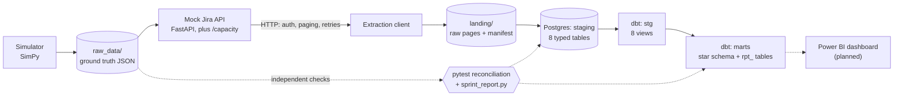

# Agile Analytics Pipeline (AAP)

[Version française](README.fr.md)

A data pipeline that combines Jira delivery data with team capacity data across several teams, and answers six questions about how much each team delivers against the people it actually had.

## At a glance

- **Problem.** Jira reports on one team at a time and has no notion of team capacity. A cross-team view of delivery against capacity needs its own pipeline.
- **What it does.** Extracts Jira-shaped data and capacity data for three teams over 12 sprints each. Loads them into a Postgres warehouse, models a star schema in dbt, and answers six business questions as ready-to-read tables.
- **Stack.** Python 3.13, SimPy, FastAPI, httpx, PostgreSQL 18 in Docker, dbt Core 1.12, pytest, uv. Power BI dashboard planned.
- **Proof.** Sprint metrics equal an independent answer key (`simulator/sprint_report.py`) on all 36 sprints. Staging equals the simulator's ground truth row by row. 134 pytest tests, 229 dbt data tests and 30 hook tests pass. 34 sabotage tests show the checks can fail.
- **Data.** Simulated, and served through a mock of Jira's real REST contract ([why](#a-note-on-the-data)).
- **Try it.** [Quick start](#quick-start): one command builds the warehouse from an empty database, in about 25 seconds from a clone once the downloads are done.

## Why this project exists

### The problem

Jira's built-in reports (velocity chart, sprint report, burndown) are scoped to one board. A cross-team portfolio view needs paid add-ons. Jira also has no concept of capacity: it does not know how many people a team had in a sprint, or how many days they were away. Two teams with the same velocity are not equivalent if one of them lost a fifth of its time to leave.

This project builds the missing layer. It blends delivery data from Jira with capacity data (headcount and days off per team and sprint) across teams, in one warehouse.

### The purposes

1. **An internship deliverable.** It is the data engineering deliverable of an internship at ISICOD.
2. **A portfolio project.** It shows the work of a junior data or analytics engineer end to end: consuming a real API contract, loading data safely, modeling it, defining metrics precisely, and proving the numbers are right. Every design choice is recorded with the options that were rejected ([decision log](docs/decisions.md)).

### A note on the data

**The data is simulated.** No real company Jira data was available. A public Jira instance was considered and rejected: those are open-source bug trackers, with no sprints and no stable teams ([D-001](docs/decisions.md#d-001-synthetic-data-from-a-simulator-not-a-public-jira-instance)).

**The pipeline is built against a mock API that replicates Jira's real REST contract** (paging, custom fields, timestamp formats), **because the live Jira API cannot backdate history.** Jira Cloud stamps every creation and status change at the moment of the API call. Months of sprint history therefore cannot be loaded into a real Jira site, and the time-in-status and sprint questions depend on that history.

So a discrete-event simulation (SimPy) generates three teams with different working styles. A FastAPI server then serves that data in Jira's response shapes: token paging on search, offset paging elsewhere, story points in `customfield_10016`, two timestamp styles. [`docs/mock-api.md`](docs/mock-api.md) lists which parts of the contract were confirmed against Atlassian's published specs and which are assumptions. The extraction client is written as it would be for a real Jira site.

Capacity has no Jira contract to imitate, so it comes from a small `/capacity` endpoint of our own design, kept separate from the Jira-shaped endpoints ([D-008](docs/decisions.md#d-008-capacity-through-its-own-small-rest-endpoint)).

## Architecture



Solid arrows are the data flow. The dotted checks read `raw_data/` directly, without the API or the pipeline's code, and compare it with the warehouse.

| Stage | Purpose | Technology | Code | Documented in |
|---|---|---|---|---|
| Simulation | Generates the ground truth: 3 teams, 12 users, 36 sprints, 530 issues, 1,488 status changes, 36 capacity rows (seed 22) | Python, SimPy, numpy | [`simulator/`](simulator/), [`scripts/generate_raw_data.py`](scripts/generate_raw_data.py) | [domain-model.md](docs/domain-model.md) |
| Mock Jira API | Serves the ground truth in Jira's REST shape, plus `/capacity` | FastAPI, uvicorn | [`mock_api/`](mock_api/) | [mock-api.md](docs/mock-api.md) |
| Extraction | Pages through every endpoint and lands each response untouched, with a manifest | Python, httpx | [`ingestion/client.py`](ingestion/client.py), [`ingestion/extract.py`](ingestion/extract.py) | [01-extraction.md](docs/etl/01-extraction.md) |
| Staging | Parses the landed pages into 8 typed tables, in one transaction | Python, psycopg 3, PostgreSQL 18 in Docker | [`ingestion/parse.py`](ingestion/parse.py), [`ingestion/load_staging.py`](ingestion/load_staging.py), [`warehouse/`](warehouse/docker-compose.yml) | [02-staging.md](docs/etl/02-staging.md) |
| dbt star schema | Renames in `stg` views, then 4 dimensions and 3 facts in `marts` | dbt Core 1.12, dbt-postgres 1.11 | [`dbt/models/staging/`](dbt/models/staging/), [`dbt/models/marts/`](dbt/models/marts/) | [03-dbt-star-schema.md](docs/etl/03-dbt-star-schema.md) |
| Metrics | Sprint metrics and the six business questions, as 10 `rpt_` tables | dbt (SQL) | [`dbt/models/metrics/`](dbt/models/metrics/) | [04-metrics.md](docs/etl/04-metrics.md), [metrics/](docs/metrics/README.md) |
| One-command run | Runs every stage from an empty database, starts and stops the mock API, and checks after each stage that nothing was lost | Python | [`pipeline/`](pipeline/) | [05-pipeline.md](docs/etl/05-pipeline.md) |
| Dashboard | Power BI report on the `rpt_` tables | Power BI | [`dashboard/`](dashboard/) (empty) | planned, not started |

## The six business questions

Results from the shipped dataset (seed 22). Each model is a table in schema `marts`.

| # | Question | Headline result | Model | Page |
|---|---|---|---|---|
| 1 | How many story points does each team finish per sprint, and what is the trend? | Phoenix 42.4, Nomad 18.9, Atlas 11.8 points per sprint. 343 points (28.1% of all completed) finish after their sprint ends and count in no sprint. | `rpt_q1_velocity` | [q1](docs/metrics/q1-velocity.md) |
| 2 | How much does each team deliver for the capacity it actually had? | 0.87, 0.53 and 0.41 points per available person-day (Phoenix, Nomad, Atlas). The gap mostly reflects how many hours a point costs in each team. | `rpt_q2_velocity_vs_capacity` | [q2](docs/metrics/q2-velocity-vs-capacity.md) |
| 3 | How often is work finished after its due date, by issue type and team? | Resolved only: Story 20.4%, Task 28.9%, Bug 38.8%. 3 issues are open and overdue at the end of the data. Scope-added work is late far more often than committed work. | `rpt_q3_breach_rate`, `rpt_q3_deadline_outcomes` | [q3](docs/metrics/q3-breach-rate.md) |
| 4 | How long does work sit in each status? | Median 74.8 h in In Progress, 4.6 h in Code Review, 19.0 h in QA (calendar hours, all teams). To Do (912.5 h) is mostly backlog wait. | `rpt_q4_time_in_status`, `rpt_q4_status_stays` | [q4](docs/metrics/q4-time-per-status.md) |
| 5 | How many Bugs does each team create per Story, over time? | Nomad 0.79, Phoenix 0.68, Atlas 0.25. | `rpt_q5_bug_to_story_ratio` | [q5](docs/metrics/q5-bug-to-story.md) |
| 6 | How do the teams compare side by side, once team size is taken into account? | Phoenix delivers the most per person-day but hits its commitment least often (5 of 12 sprints). Atlas hits most often (9 of 12) but has the highest breach rate (33.3%). Nomad loses the most time to PTO (10.3%). | `rpt_q6_team_portfolio` | [q6](docs/metrics/q6-portfolio.md) |

All of them build on `rpt_sprint_metrics`: committed, scope added and completed story points per sprint, compared on exact timestamps, never calendar days ([04-metrics.md](docs/etl/04-metrics.md)). The index of all metric pages, with the limits they share, is [docs/metrics/](docs/metrics/README.md).

## Engineering practices

What makes the numbers trustworthy, with the evidence for each.

- **Independent verification against ground truth.** The checks never go through the pipeline's own code.
  - All 8 staging tables equal `raw_data/` row by row. The test reads the JSON with the standard library, imports nothing from `mock_api/` or the parser, and checks that it doesn't ([02-staging.md](docs/etl/02-staging.md#reconciliation-with-raw_data-step-23)).
  - Sprint metrics equal the simulator's answer key on all 36 sprints, for all six values it reports ([04-metrics.md](docs/etl/04-metrics.md#reconciliation-with-the-answer-key-pytest)).
  - Questions 1 to 5 are recomputed in plain Python from `raw_data/`, and question 6 must equal them team by team ([`tests/test_metrics.py`](tests/test_metrics.py)).
  - A test proves that no raw timestamp falls in the first millisecond after a sprint boundary, so the exact match is not luck ([D-035](docs/decisions.md#d-035-the-millisecond-floor-is-checked-at-sprint-boundaries-not-tolerated)).
- **Sabotage tests.** 34 `test_sabotage_*` functions break one thing on purpose and assert that the right check fails. Examples: comparing calendar days instead of timestamps changes 17 of the 36 sprints. A flipped breach comparison turns 20.4% into 79.6%. Dropping one landed page fails the counts. Without the hooks, 18 of the 28 hook cases fail ([workflow.md](docs/workflow.md#testing-the-hooks)).
- **Idempotent and atomic loading.**
  - Extraction writes to a scratch directory and replaces `landing/` only after a successful run. A rerun is byte-identical ([01-extraction.md](docs/etl/01-extraction.md)).
  - Staging loads in one transaction (`TRUNCATE` then `COPY`). A failed run leaves the previous rows exactly as they were, and dbt views on staging survive a reload. Tests cover both ([D-022](docs/decisions.md#d-022-staging-reloads-by-truncate-and-copy-drop-and-recreate-only-on---rebuild)).
- **Star schema with a declared grain.** 4 dimensions (team, user, sprint, issue) and 3 facts (status transition, sprint membership, capacity per team and sprint), on natural keys ([03-dbt-star-schema.md](docs/etl/03-dbt-star-schema.md#schema-or-contract)).
- **Data tests in dbt.** 229 data tests: unique, not null, relationships, accepted values, row counts, and 12 singular tests. For example: every transition falls in exactly one sprint window, and every breach-rate rollup equals the sum of its parts ([`dbt/tests/`](dbt/tests/)).
- **Runtime completeness checks.** Separate from the tests: after each stage of a real run, [`pipeline/completeness.py`](pipeline/completeness.py) compares counts with the stage before (manifest, landed files, staging, marts, `rpt_` tables). A lost row stops the run with exit 3 and a message naming the stage and both counts ([D-044](docs/decisions.md#d-044-the-completeness-check-is-its-own-module-and-compares-counts-between-adjacent-stages)).
- **Git hooks.** `commit-msg` enforces Conventional Commits. `pre-commit` refuses commits on `main`, and refuses code changes under `ingestion/`, `pipeline/`, `warehouse/` or `dbt/` without a change under `docs/`. [`scripts/test_hooks.sh`](scripts/test_hooks.sh) runs 30 cases in a throwaway repository ([workflow.md](docs/workflow.md#hooks)).
- **Decision log.** 47 recorded decisions (D-001 to D-047), each with its context, the options considered and why they lost ([decisions.md](docs/decisions.md)).
- **No secrets in the repository.** Every credential comes from the environment through `--env-file .env`. Only [`.env.example`](.env.example), with placeholders, is tracked.

**Test counts** (run on 2026-11-06): `pytest` 134 passed, 0 skipped (extraction 18, staging 33, reconciliation 10, dbt 19, metrics 26, mock API verification 4, pipeline 24), in both normal and reverse order. `dbt build` PASS=254 (8 views, 17 tables, 229 data tests). Hook tests 30 passed. The mock API's two verification scripts cover its 48 documented claims ([mock-api.md](docs/mock-api.md#7-verification-status)).

## Skills demonstrated

| Skill | Where in the repository |
|---|---|
| API consumption: Bearer auth, token and offset paging, retries on transient errors only | [`ingestion/client.py`](ingestion/client.py), [01-extraction.md](docs/etl/01-extraction.md) |
| API design: a mock of a real REST contract, plus an endpoint of our own | [`mock_api/`](mock_api/), [mock-api.md](docs/mock-api.md) |
| Parsing a real contract: custom fields, two timestamp formats, a fixed status map | [`ingestion/parse.py`](ingestion/parse.py), [02-staging.md](docs/etl/02-staging.md) |
| ETL with idempotent, transactional loading | [`ingestion/extract.py`](ingestion/extract.py), [`ingestion/load_staging.py`](ingestion/load_staging.py) |
| Data modeling: star schema, grain, natural keys | [`dbt/models/marts/`](dbt/models/marts/), [03-dbt-star-schema.md](docs/etl/03-dbt-star-schema.md) |
| SQL and dbt: window functions, `group by cube`, percentiles, custom generic tests | [`dbt/models/metrics/`](dbt/models/metrics/), [`dbt/tests/generic/`](dbt/tests/generic/) |
| Metric definition: exact rules, stated assumptions and limits | [docs/metrics/](docs/metrics/README.md) |
| Data quality testing and reconciliation | [`tests/`](tests/), [`dbt/tests/`](dbt/tests/) |
| Docker: a pinned Postgres image, health check, named volume | [`warehouse/docker-compose.yml`](warehouse/docker-compose.yml) |
| Discrete-event simulation, with calibration on held-out seeds | [`simulator/`](simulator/), [domain-model.md](docs/domain-model.md#calibration-seed-set-decision) |
| Python tooling: uv, pytest, locked dependencies | [`pyproject.toml`](pyproject.toml), [`uv.lock`](uv.lock) |
| Git workflow automation | [`.githooks/`](.githooks/), [workflow.md](docs/workflow.md) |
| Documentation and decision records | [`docs/`](docs/), [decisions.md](docs/decisions.md) |

## Quick start

**Prerequisites:** Linux or WSL2 Ubuntu, [Docker](https://docs.docker.com/engine/install/) with Compose, and [uv](https://docs.astral.sh/uv/) (it installs Python 3.13 if needed). Port 5433 (Postgres) and port 8000 (mock API) must be free.

All commands run from the repository root.

```bash
# 1. Clone, configure, install
git clone https://github.com/YassineBelhamadia/Agile-Analytics-Pipeline.git
cd Agile-Analytics-Pipeline
cp .env.example .env      # then replace the two placeholders with any local values
uv sync

# 2. Generate the simulated ground truth (seeded: the same files on every run)
uv run python scripts/generate_raw_data.py

# 3. Start Postgres and check the connection
docker compose --env-file .env -f warehouse/docker-compose.yml up -d --wait
uv run --env-file .env python scripts/check_warehouse.py

# 4. Run the whole pipeline: extract, load staging, build and test the dbt models.
#    It starts and stops the mock API itself.
uv run --env-file .env python -m pipeline.run

# 5. Run the full test suite (Postgres tests use their own schemas and databases)
uv run --env-file .env python -m pytest -rs
```

Exit codes: 0 success, 1 a stage failed, 2 a precondition failed and nothing was written, 3 a completeness check failed, 130 interrupted. The [clean-run guide](docs/clean-run.md) has the full walk-through, and [05-pipeline.md](docs/etl/05-pipeline.md#schema-or-contract) says what a failed run leaves behind.

For a quick check with no database, `uv run python -m pytest -m "not postgres"` runs 56 tests in about 25 seconds. It is not a substitute for the full suite.

**How long it takes.** Measured from a fresh clone and an empty database, with the Docker image and the uv cache already downloaded: steps 1 to 4 take about 25 seconds (`dbt build` is about 13 of them). The test suite took 5 min 39 s, measured after step 5.2 on this project's development machine (16 logical cores, 15 GB of memory, WSL2). These times depend on the machine. A first run also downloads the Postgres image and the Python packages.

<details>
<summary>What success looks like</summary>

- `generate_raw_data.py` ends with `'teams': 3, 'users': 12, 'sprints': 36, 'issues': 530, 'status_transitions': 1488, 'sprint_issue_memberships': 320, 'capacities': 36`.
- `pipeline.run` exits 0 and prints the seconds per stage and the counts per layer:
  - `landing/` holds 578 pages (530 of them changelogs) plus `manifest.json`.
  - `staging` holds 3 teams, 12 users, 3 boards, 36 sprints, 36 capacity rows, 530 issues, 1,488 status transitions and 320 sprint memberships.
  - `dbt build`, inside it, ends with `PASS=254 WARN=0 ERROR=0`.
- `pytest -rs` ends with `134 passed`, and no test is skipped.

</details>

<details>
<summary>Look at a result, stop, and other checks</summary>

Query the portfolio table (user and database are the defaults from `.env.example`):

```bash
docker compose --env-file .env -f warehouse/docker-compose.yml exec postgres \
  psql -U aap -d aap_warehouse -c "select team_name, round(velocity_per_sprint, 1) as velocity, round(points_per_person_day::numeric, 2) as points_per_person_day, round(100 * hit_rate, 1) as hit_pct, round(100 * breach_rate_resolved, 1) as breach_pct from marts.rpt_q6_team_portfolio order by team_id"
```

```
 team_name | velocity | points_per_person_day | hit_pct | breach_pct
-----------+----------+-----------------------+---------+------------
 Phoenix   |     42.4 |                  0.87 |    41.7 |       24.1
 Nomad     |     18.9 |                  0.53 |    50.0 |       30.2
 Atlas     |     11.8 |                  0.41 |    75.0 |       33.3
```

Verify the mock API against the ground truth (no server or database needed):

```bash
uv run python -m mock_api.verify        # ends with ALL CHECKS PASSED
uv run python -m mock_api.verify_app    # ends with ALL APP CHECKS PASSED
```

Enable and test the git hooks (once per clone, for contributors):

```bash
git config core.hooksPath .githooks
sh scripts/test_hooks.sh                # expect "30 passed, 0 failed"
```

Stop Postgres. The data stays in the named volume:

```bash
docker compose --env-file .env -f warehouse/docker-compose.yml down
```

</details>

## Repository layout

```
.
├── simulator/          SimPy simulation and the sprint report answer key (sprint_report.py)
├── scripts/            generate_raw_data.py, check_warehouse.py, test_hooks.sh
├── mock_api/           FastAPI app: Jira-shaped endpoints plus /capacity, and two verify scripts
├── ingestion/          client.py and extract.py (to landing/), parse.py and load_staging.py (to staging)
├── pipeline/           one-command run, mock API subprocess, runtime completeness checks
├── warehouse/          docker-compose.yml for PostgreSQL 18.6
├── dbt/
│   ├── models/staging/ 8 stg_ views
│   ├── models/marts/   4 dimensions, 3 facts
│   ├── models/metrics/ rpt_sprint_metrics and the business-question tables
│   └── tests/          singular tests and 2 custom generic tests
├── tests/              pytest: extraction, staging, reconciliation, dbt, metrics, verify scripts, pipeline
├── docs/               decisions, domain model, API reference, one page per stage and per question
├── dashboard/          Power BI report (planned, empty)
├── .githooks/          commit-msg and pre-commit
└── .env.example        placeholder settings, copied to .env
```

Generated and gitignored: `raw_data/` (ground truth), `landing/` (raw API pages), `dbt/target/`, `dbt/logs/`, `.env`.

## Documentation

- **Project and process**
  - [stack.md](docs/stack.md): tool choices, why, and what is deferred
  - [decisions.md](docs/decisions.md): the decision log, D-001 to D-047
  - [decision-log.md](docs/decision-log.md): the early narrative record, superseded by decisions.md and kept for history
  - [workflow.md](docs/workflow.md): branches, gates, commit format, hooks, permissions
  - [etl-plan.md](docs/etl-plan.md): every planned commit, with its gate
  - [clean-run.md](docs/clean-run.md): from a fresh clone to every documented count
- **Data and contracts**
  - [domain-model.md](docs/domain-model.md): entities, sprint metric definitions, deadline rule, calibration, v1 limitations
  - [mock-api.md](docs/mock-api.md): endpoints, paging, JQL, errors, what is confirmed vs. assumed
  - [mock_api/README.md](mock_api/README.md): running the mock API
- **Pipeline stages** ([index](docs/etl/README.md))
  - [01-extraction.md](docs/etl/01-extraction.md), [02-staging.md](docs/etl/02-staging.md), [03-dbt-star-schema.md](docs/etl/03-dbt-star-schema.md), [04-metrics.md](docs/etl/04-metrics.md), [05-pipeline.md](docs/etl/05-pipeline.md) (planned)
- **Business questions** ([index](docs/metrics/README.md))
  - [q1-velocity.md](docs/metrics/q1-velocity.md), [q2-velocity-vs-capacity.md](docs/metrics/q2-velocity-vs-capacity.md), [q3-breach-rate.md](docs/metrics/q3-breach-rate.md), [q4-time-per-status.md](docs/metrics/q4-time-per-status.md), [q5-bug-to-story.md](docs/metrics/q5-bug-to-story.md), [q6-portfolio.md](docs/metrics/q6-portfolio.md)

## Project status and roadmap

| Stage | Status |
|---|---|
| Simulator and ground truth (`raw_data/`) | done |
| Mock Jira API, with `/capacity` | done |
| Postgres warehouse in Docker | done |
| Extraction client and raw landing | done |
| Staging tables, reconciled with the ground truth | done |
| dbt star schema and data tests | done |
| Sprint metrics and the six business questions | done |
| One-command pipeline run from an empty database, with runtime completeness checks | done |
| pytest wrappers for the verification scripts | done |
| Final pipeline docs and clean-run guide | done |
| CI on GitHub Actions, with a Postgres service container | planned, separate branch |
| Power BI dashboard | planned, not started |
| Orchestration (Airflow or similar) | deferred until v1 runs end to end ([D-006](docs/decisions.md#d-006-orchestration-and-the-dbt-vs-plain-sql-write-up-are-deferred)) |

**Known v1 limitations** (from [domain-model.md](docs/domain-model.md#known-v1-limitations) and the stage pages):

- **No carryover.** Unfinished work stays in its original sprint. 65 issues finish after their sprint ended, so their 343 points count in no sprint's velocity and they all count as late.
- **One team per user.** Nobody splits time across teams.
- **PTO is recorded per team,** not per person.
- **Fixed sprint length.** Every sprint has ten working days, with no extensions or holidays.
- **Epics never change status,** and are excluded from time-based metrics.
- **No priority field,** on purpose: it would influence nothing in v1.
- **Scope creep is not scaled to team size.** It weighs most on the smallest team (Atlas).
- **Story points are team-relative.** A point costs 3.5 to 6 hours of work depending on the team, so points compare a team with itself over time.
- **Durations are in calendar hours,** nights and weekends included. There is no date dimension yet.
- **Full refresh only.** Extraction and staging reload everything, requests are sequential, and the whole landing is parsed in memory.

**Next.** CI on its own branch ([etl-plan.md](docs/etl-plan.md#step-54-github-actions-ci-planned-separate-branch)), then the Power BI dashboard on the `rpt_` tables. v1.1 candidates named in the docs: carryover, priority-aware queueing, staggered sprint starts.

## About the author

**Yassine Belhamadia**, final-year master's student. This project is the data engineering deliverable of my internship at ISICOD. I am looking for an end-of-studies internship (PFE) in data engineering or analytics engineering, mainly in France, Germany and Morocco.

- GitHub: [YassineBelhamadia](https://github.com/YassineBelhamadia)
- LinkedIn: `www.linkedin.com/in/belhamadiayassine0220`
- Email: `yassinebelhamadia28@gmail.com`
- Master's programme and university: `Universite mohammed V de Rabat - Faculte de science`

License: [MIT](LICENSE).
