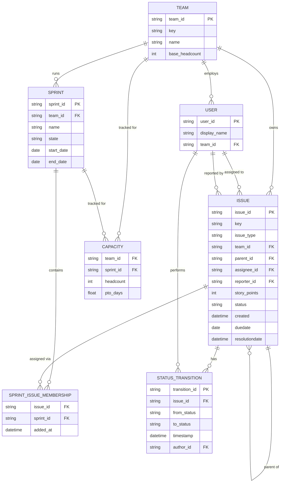

# Domain Model — Agile Analytics Pipeline (AAP)

This document is the source of truth for the simulator's internal data model and how it maps to Jira's actual API contract. Read this before writing or modifying `simulator/`, `mock_api/`, or `ingestion/` code. See `docs/decision-log.md` for the higher-level project decisions this builds on.

## Core principle: ground truth vs. views

The simulator produces one rich, internally-consistent **ground truth** — every team, user, issue, transition, and sprint membership, fully known because the simulation controls it. The mock API does not store a second copy of this data in Jira's shape; instead, each endpoint is a **serializer function** that projects a slice of the ground truth into whatever a specific real Jira endpoint would return (e.g. `GET /issue/{key}`, `GET /issue/{key}/changelog`, the Sprint Report).

This means: build the simulator's internal model first, independent of any Jira JSON shape. Write the Jira-shaped serialization as a separate layer on top.

**The changelog carries both status and sprint items.** `GET /issue/{key}/changelog` emits one history per STATUS_TRANSITION (`field: "status"`) *and* one per SPRINT_ISSUE_MEMBERSHIP (`field: "Sprint"`, `fieldId: "customfield_10020"`), merged in chronological order. The sprint items aren't decoration — they're the only place in the Jira-shaped payload that says *when* an issue joined a sprint, so the ingestion layer derives committed vs. scope-added from them (comparing each sprint item's timestamp against the sprint's `startDate`), the same way real Jira integrations do.

## Entities and relationships

### Relationships in plain language

This section says the same thing as the diagram above, in sentences — read this if the diagram's notation (`||--o{` etc.) isn't obvious at a glance. "One-to-many" below means: one row on the left can relate to many rows on the right, but each row on the right points back to exactly one row on the left.

- **A TEAM has many USERs.** Every user belongs to exactly one team.
- **A TEAM runs many SPRINTs.** A sprint belongs to exactly one team.
- **A TEAM owns many ISSUEs.** Every issue belongs to exactly one team.
- **A TEAM has many CAPACITY records over time** (one per sprint it runs).
- **A SPRINT has many CAPACITY records** — in practice exactly one per sprint (a sprint's headcount/PTO snapshot), but modeled as one-to-many rather than one-to-one in case a later version wants to track a mid-sprint capacity correction.
- **A SPRINT contains many issues, through SPRINT_ISSUE_MEMBERSHIP** — this is a *join table*: it doesn't link SPRINT directly to ISSUE, it links each one to a SPRINT_ISSUE_MEMBERSHIP row instead, because that row needs to carry its own extra fact (`added_at` — when the issue joined). The schema permits an issue to be a member of more than one sprint over its lifetime (e.g. rolling an unfinished ticket into the next sprint) — nothing currently prevents this — but no generator process creates that today; every issue in the current simulation belongs to at most one sprint. This is schema flexibility for a possible future extension, not current behavior. A sprint obviously contains many issues.
- **An ISSUE has many STATUS_TRANSITIONs** — one row per status change (To Do → In Progress, In Progress → Code Review, etc.). This is the full history; `Issue.status` itself only ever holds the *current* status as a convenience.
- **An ISSUE can be the parent of many other ISSUEs** — this is the Epic → Story and Story → Task/Bug relationship, and it points back to the *same* entity (a "self-relationship"). An issue has at most one parent, but a parent can have many children.
- **A USER can perform many STATUS_TRANSITIONs** — this is "who moved this ticket," tracked via `author_id` on each transition row.
- **A USER can be the assignee on many ISSUEs** — "who is currently working this ticket," via `Issue.assignee_id`.
- **A USER can be the reporter on many ISSUEs** — "who originally filed this ticket," via `Issue.reporter_id`. This is a *separate* relationship from assignee — the same user can, and often does, show up as both the assignee on some issues and the reporter on others, but on any single issue those two fields can hold different users (or the same one).

## Entity notes

### TEAM (~ Jira Project)
One Jira "project" per team. `base_headcount` is simulator-internal only — Jira has no concept of headcount, which is exactly the gap this project fills.

### USER
Maps to Jira's `accountId` / `displayName` on `assignee`, `reporter`, and changelog `author`. Each user belongs primarily to one team for simulation purposes.

### SPRINT
Maps to the sprint object embedded in Jira's custom field array (e.g. `customfield_10020`). Note: `committed_points`, `completed_points`, and `scope_added_points` are **not** stored fields here — they're computed from `SPRINT_ISSUE_MEMBERSHIP` + `STATUS_TRANSITION`, the same way Jira's own Sprint Report computes them.

### ISSUE
Maps to `fields.*` on a Jira issue payload. Key points:
- `parent_id` is self-referential, modeling Jira's Epic Link concept — a simplification of Jira's real split between `parent` (subtasks) and the Epic Link custom field, made deliberately for v1. Currently only Epic→Story/Task/Bug links are generated (an Epic can be the parent of any issue type). Story→Task/Bug sub-linking (a Task belonging to a specific Story, independent of any Epic) is schema-supported — the field itself imposes no restriction — but no generator process creates this today; it's a possible future extension, not a current behavior.
- `story_points`: see the "Story points by issue type" decision below.
- `status` here is the issue's **current** status (a denormalized convenience); the authoritative history lives in `STATUS_TRANSITION`.
- `created` and `resolutiondate` are `datetime` (not `date`): they need full timestamp precision for cycle-time calculations, since `STATUS_TRANSITION.timestamp` is datetime-precision and Issue's own created/resolutiondate must match it or cycle-time math would silently lose precision. `duedate` stays `date`, since real Jira's duedate genuinely has no time component.

### STATUS_TRANSITION
The fact-table grain. Maps to one entry in `changelog.histories[].items[]` where `field == "status"`. One row per status change, with a timestamp — this is what makes cycle-time and time-in-status questions answerable.

### SPRINT_ISSUE_MEMBERSHIP
Added during domain modeling — not in the original skeleton. Tracks when an issue joined a sprint (`added_at`). Without this, "committed vs. completed vs. scope-added" (business question inputs) cannot be computed: you'd only know an issue's current sprint, not whether it was there from day one or added mid-sprint. This is the internal equivalent of what Jira's Sprint Report computes on the fly.

### CAPACITY
Tied to both TEAM and SPRINT — a capacity record is "this team, in this specific sprint, had this many people available" (`headcount`, `pto_days`). It's deliberately **not** connected to any Jira-side entity (Issue, StatusTransition, etc.) — see the ingestion note below for why it's ingested through a separate path from the Jira-shaped data, even though it relates to Team and Sprint just like the rest of the model.

## Story points by issue type (decision)

- **Epic**: no direct `story_points` field. If shown at all, it's a rollup (sum) of child stories' points — computed, not stored.
- **Story**: primary point-bearing unit. Required.
- **Task**: has `story_points`, following common team convention for standalone backlog tasks.
- **Bug**: **decided to carry `story_points` and count toward velocity** (rather than the stricter Scrum-purist convention of leaving bugs unpointed). Rationale: more realistic — most real teams do this — and it makes the "velocity vs. capacity" story richer, since a bug-heavy sprint will visibly show reduced "new value" velocity even at full capacity.

## Jira API realism decision: story points as a real field vs. `customfield_XXXXX`

Real Jira exposes story points as an opaque custom field (e.g. `customfield_10016`), since story points aren't a native Jira concept. For maximum mock-API fidelity, the mock API's JSON should use `customfield_XXXXX` naming, and the **ingestion client** should be responsible for mapping it to a clean internal field — this mapping step is itself realistic, defensible engineering (real Jira integrations always have to do this). Simplifying to a clean `story_points` key directly in the mock API is an acceptable v1 shortcut, but if taken, state it as a simplification if asked in an interview — same honesty standard as the other decisions in the project log.

## Where "commit vs. completion vs. scope-added" actually comes from

These numbers are **not** native fields on a Sprint object in real Jira — they're computed by Jira's Sprint Report, by comparing which issues were in the sprint at start vs. end. That report endpoint is part of the (semi-legacy, less formally documented) Jira Software API — worth a dedicated fidelity check later if exact field names matter. Conceptually, in this project:

All three compare **exact timestamps**, not calendar days. `SPRINT.start_date`/`end_date` are stored as dates, but the simulator cuts sprints at the start of a workday (09:00), so the sprint start and end *instants* are those dates at 09:00 — and one sprint's end instant is the next sprint's start instant. The mock API's sprint `startDate`/`endDate` use the same instants, so these figures match what a client computes from the API payload.

- **Committed** = sum of `story_points` for issues where `SPRINT_ISSUE_MEMBERSHIP.added_at` <= the sprint start timestamp
- **Scope added** = sum of `story_points` for issues where `added_at` > the sprint start timestamp
- **Completed** = sum of `story_points` for issues whose `resolutiondate` is set and is <= the sprint end timestamp. (In implementation, this reads the denormalized `Issue.resolutiondate` field directly rather than querying `STATUS_TRANSITION` history — equivalent in practice, since `resolutiondate` is only ever set at the same instant the "→ Done" transition is recorded, but worth naming accurately since it's a real implementation choice, not just a conceptual shorthand.)

*(Earlier versions compared calendar days — `added_at.date() <= start_date`, `resolutiondate.date() <= end_date`. That counted scope added later on the start day as committed, and work resolved after 09:00 on the end day as completed in a sprint that had already ended. Switching to timestamps lowered every team's hit rate, and `capacity_realization_factor` was retuned to compensate — see "Recalibrated after the sprint-report fix" below.)*

`sprint_report.py`'s actual output also includes `hit` (whether `completed >= committed` for that sprint — see the Block 5 decision log entry below) and a per-sprint bug count / total issue count, used for the bug-ratio business question. These aren't part of the three core formulas above but are computed alongside them.

## Deadline (duedate) rule (decision)

An issue gets a `duedate` when it first joins a sprint (`assign_duedate` in `simulator/sprint_cycle.py`, called at sprint planning and at mid-sprint scope adds):

- **Story and Task:** due on the sprint's last workday, the workday before `end_date`. Work happens only during working hours, so `resolutiondate.date() <= duedate` gives the same answer as the exact sprint-end comparison. `mock_api.verify.check_duedates` confirms this for every resolved Story and Task.
- **Bug:** due `BUG_DEADLINE_WORKDAYS = 5` workdays after the day it joined, capped at the sprint's last workday.
- **No due date:** Epics (never in a sprint) and issues never pulled into a sprint keep `duedate = null`.
- **Repeat memberships:** only the first membership sets the date. None exist today, since there is no carryover.

The 5-workday bug SLA is an **authored policy**, fixed before any breach rate was measured. It is not calibrated and must not be tuned to hit a target. The rule draws no random numbers, so adding it changed only the `duedate` field. Every other generated value is byte-identical.

**Breach definition** (business question 3), for issues with a non-null `duedate`:

- **Breached:** resolved with `resolutiondate.date() > duedate`, or unresolved at the as-of date with `duedate` before it.
- **On time:** resolved with `resolutiondate.date() <= duedate`.
- **Excluded:** unresolved and not yet due (censored), and every issue with a null `duedate`.
- **Two rates:** report *resolved only* and *including unresolved past due*. The as-of date is the last timestamp in the data.

In the shipped dataset (SEED=22), 320 issues have a due date (155 Story, 76 Task, 89 Bug) and 210 don't (30 Epics, 180 never scheduled). Resolved-only breach rates: Story 20.4%, Task 28.9%, Bug 38.8%.

**Breach is not the inverse of sprint hit.** Hit compares *completed* points with *committed* points, so late scope-added work barely affects it. Breach counts every issue with a deadline, scope-added ones included, and scope-added issues join with less time left. Atlas shows the gap: the best hit rate (9/12) but the highest breach rate (33%). Its committed issues are the most punctual of the three teams (14% late). Its scope-added issues are late 64% of the time, because scope adds arrive at the same rate for every team (`SCOPE_ADD_POISSON_MEAN`), which adds 65% on top of Atlas's small commitment. Only one of Atlas's nine hits relies on completed scope-added points covering unfinished committed ones. Split breach by committed vs. scope-added when presenting it.

## Ingestion split: Jira-shaped data vs. Capacity data (decision)

This is the key architectural asymmetry in the pipeline:

- **Jira-shaped data (Team, User, Sprint, Issue, StatusTransition)** must be faithful to a **real, external contract** — that fidelity is the actual engineering skill being demonstrated (see decision log 5.5). It goes through the mock API, shaped like real Jira REST responses.
- **Capacity data has no real universal contract to be faithful to** — every company tracks headcount/PTO differently (HR tool, spreadsheet, a side table in some other system). There's nothing to reverse-engineer, so this is a free, deliberate design choice rather than a fidelity requirement.

**Decided approach:** serve Capacity through its own small, custom REST endpoint (e.g. `GET /capacity?team=X&sprint=Y`), separate from the Jira-shaped mock API, with its own simple schema of our own design (not modeled on any real product). This keeps the ingestion layer architecturally symmetric — two clients, two APIs, same pattern — rather than mixing an API client with a flat-file reader.

*(Alternative considered: serve Capacity as a flat CSV instead, which is arguably just as realistic since many real companies do track capacity this way. Rejected in favor of the REST approach for pipeline consistency, but noted here as a legitimate alternative if revisited.)*

## Simulator simplification: committed work starts all at once (decision)

Sprint planning releases all committed work simultaneously at sprint start, rather than staggering it gradually. This creates a predictable early-sprint queue — developers near 100% utilized in the first ~2 days, tapering to ~43% by sprint end — that accounts for part of the low capacity-realization factor in `sprint_cycle.py`: some of that factor compensates for this start-of-sprint burst rather than purely for real-world overhead like rework and scope creep. Diagnosed via direct developer-pool sampling across a 12-sprint run. Not fixed in v1, since it doesn't affect the correctness of committed/completed/scope-added calculations, only the shape of within-sprint utilization. A v1.1 improvement would stagger committed-issue start times with a small random delay to spread the release instead of firing all at once.

## Known v1 limitations

Deliberate simplifications in the current simulator and data model. None of them blocks the six business questions, but each is a place where the data is less realistic than a real Jira instance — worth naming accurately, same honesty standard as the decisions above.

- **One team per user.** `USER.team_id` is a single foreign key, so every user belongs to exactly one team. Real organizations have people who split time across teams (a shared QA engineer, a platform specialist); the model can't express that today.
- **PTO tracked at team level only.** CAPACITY records `pto_days` as one number per team per sprint. There's no record of *which* user was out, so per-person availability questions can't be answered — only "how much capacity did this team lose this sprint."
- **Fixed sprint length, no extension tracking.** Every sprint runs exactly ten working days. Real teams sometimes extend or close a sprint early; nothing in the model records a planned-vs-actual end date, so that behavior can't be generated or analyzed.
- **No carryover of unfinished issues.** An issue that isn't Done by sprint end stays in its original sprint and is never rolled into the next one. The schema permits multi-sprint membership (see SPRINT_ISSUE_MEMBERSHIP above) and the mock API's changelog handles it correctly, but no generator process creates it — so "how often does work spill over" isn't answerable from the current data.
- **Epics never change status.** Epics are created as parents for other issues but never move through the workflow — every Epic stays in To Do for the whole simulation, even when all of its children are Done. Real teams usually close Epics once their child work ships.
- **Priority is deliberately out of scope for v1.** None of the six business questions needs it, and a field that doesn't influence anything would be decoration: a meaningful version needs priority-aware queueing (high-priority issues jumping the backlog and the developer pool) and then a recalibration of the team personalities, since queueing order changes cycle times and hit rates. A v1.1 candidate. The mock API correspondingly emits no `priority` field.

## Open items carried over from this modeling pass

- Exact Sprint Report field names (Jira Software API) — verify later if fidelity matters for the mock API's sprint-report endpoint.
- ~~Whether `reporter_id` and `priority` are worth modeling for v1.~~ Resolved: `reporter_id` is modeled; `priority` is out of scope for v1 (see "Known v1 limitations" above).

## Multi-team personality parameterization (decision)

Teams are not identical. The simulator allows **per-team parameterization** of core behaviors: `hours_per_point`, `qa_bounce_probability`, `arrival_rate_per_hour`, `issue_type_weights`, PTO distribution, `capacity_realization_factor`, and optimism range. This enables three distinct personas. Results below are averages over the 60 calibration seeds (see "Calibration seed set" below), per 12-sprint run:

- **Phoenix** (headcount=5): high velocity (3.5 hrs/point), high bug rate (~28% of arrivals), high QA rework (22%), aggressive capacity commitment (crf=0.35). Result: 43% sprint hit rate (range 8%–83% across seeds), ~162 issues completed — ships the most, misses the most.
- **Atlas** (headcount=3): slow (6.0 hrs/point), reliable (8% QA rework, 15% bugs), conservative commitment (crf=0.22, optimism factor 1.00–1.08). Result: 73% hit rate (range 25%–100%), ~57 issues completed — small commitments met consistently.
- **Nomad** (headcount=4): moderate velocity (5.0 hrs/point), high PTO variance (40% of sprints land in its high-PTO regime, averaging 3.8 PTO days/sprint vs. 1.1 for Atlas and 1.5 for Phoenix — measured across the 60 calibration seeds), crf=0.29. Result: 53% hit rate (range 17%–92%), ~89 issues completed — unpredictable sprint-to-sprint due to capacity shocks.

Overall average hit rate: 56%. The intended ordering Phoenix < Nomad < Atlas holds on average. Within individual seeds it holds strictly in 22 of 60 (34 of 60 if ties count) — the per-seed spread of every team is wide enough that any single 12-sprint run can reorder them, which is why the ordering is a target on averages only.

**Held-out check.** The same parameters measured on seeds 61–100, which were never used for tuning: Phoenix 42.9%, Nomad 55.0%, Atlas 71.2%, overall 56.4% — every team inside its band. Strict per-seed ordering: 16 of 40.

**Calibration history (decision).** `capacity_realization_factor` has been retuned twice; every other personality parameter is unchanged since the personalities were introduced.

1. *After the sprint-report fix.* The original values (Phoenix 0.42, Nomad 0.35, Atlas 0.28) were tuned when the sprint report compared calendar days, which credited work resolved after 09:00 on a sprint's last day — really the next sprint's first morning — to the sprint that had just ended, inflating every hit rate. Retuned to 0.37 / 0.30 / 0.23 on 20 seeds. That pass was fragile: teams still shared one random stream, so retuning one team moved the others by several points, and the 20-seed averages carried roughly ±3 points of seed noise — as wide as the target bands. Measured on other seeds, Phoenix fell out of band.
2. *After per-team random streams.* With teams independent (see below) and calibration widened to 60 seeds plus 40 held out, each team's crf was swept on its own and set near the middle of its band: 0.35 / 0.29 / 0.22. Targets: Phoenix 37–45%, Nomad 48–56%, Atlas 69–78%, overall 54–60%. Figures from pass 1 aren't comparable with these — the random-stream change alone moves every seeded run.

**Observed quirk (documented, not fixed):** Atlas's small total commitment per sprint (~12 story points) makes individual bad tickets disproportionately impactful — one slipped ticket can be a large share of the sprint. Despite that, it is now the *least* seed-sensitive team (per-seed hit-rate standard deviation over the 60 seeds: Phoenix ~17 points, Nomad ~17, Atlas ~15): its conservative commitment absorbs most slips. Earlier, 20-seed measurements suggested the opposite; with 60 seeds the difference is small and should not be over-read.

### Per-team random streams (decision)

Every random draw in the simulator belongs to one team — its arrivals, sprint planning, PTO, scope adds, and its issues' lifecycles — so each team gets its **own random stream**: a numpy `Generator` derived deterministically from the run's base seed and the team key (`simulator/rng.py`, SHA-256 of the key combined with the seed through numpy's `SeedSequence`). It is passed explicitly into that team's processes; nothing in the simulator touches module-level random state any more. There is no shared, non-team randomness today; if some appears it should get its own named stream rather than borrow a team's.

Previously all teams drew from one global stream, which coupled them invisibly: an extra draw by Phoenix shifted every later draw by Atlas, so changing one team's parameters changed the other teams' data and teams couldn't be calibrated independently.

Transition IDs are namespaced per team for the same reason. They used to come from one global counter (`TR-1`, `TR-2`, … across all teams), so one team's extra transitions renumbered every other team's history even with independent streams. They're now minted per team, like issue and sprint IDs: `ATL-TR-1`, `PHX-TR-1`. (The mock API's changelog IDs are hashed from `transition_id`, so they changed value but not shape.)

Verified, comparing each team's rows across all seven entity files byte for byte: the same seed reproduces `raw_data/` byte-identically; changing Phoenix's crf leaves Atlas's and Nomad's data byte-identical; adding a fourth team leaves the existing three teams' data byte-identical. SimPy's event ordering preserves this — another team's events can interleave with a team's own, but never reorder them.

### Calibration seed set (decision)

Calibration is tuned on **seeds 1–60** (`CALIBRATION_SEEDS`) and checked on **seeds 61–100** (`HOLDOUT_SEEDS`), both pinned in `simulator/calibration.py`. Run `python -m simulator.calibration` to print, for each set, every team's crf, average hit rate, min–max range and completed issues, plus the overall average and how many seeds preserve the Phoenix < Nomad < Atlas ordering. Held-out seeds are never used for tuning — they exist to show whether the parameters describe the simulation or just fit the seeds they were tuned on. Because teams have independent streams, a team's figures depend only on its own parameters, so each team can be tuned alone. Changing either seed set invalidates previously reported calibration figures, so treat both as part of the targets.

This is separate from `SEED` in `simulator/clock.py`, the single seed that produces `raw_data/`. It is **22**, selected as a typical run rather than at random: of seeds 1–100, it's the closest to the 60-seed averages among those where Phoenix < Nomad < Atlas holds strictly (tied on hit rates with seeds 69 and 50, and closest of the three on completed issues). The shipped dataset therefore shows Phoenix 42% (5 of 12 sprints hit, 170 issues completed), Nomad 50% (6 of 12, 86), Atlas 75% (9 of 12, 57) — 56% overall, against 60-seed averages of 43% / 53% / 73%. The previous seed, 11, had drifted to 50% / 42% / 58% under the current calibration, putting Nomad below Phoenix. Re-check the choice whenever the calibration changes.
