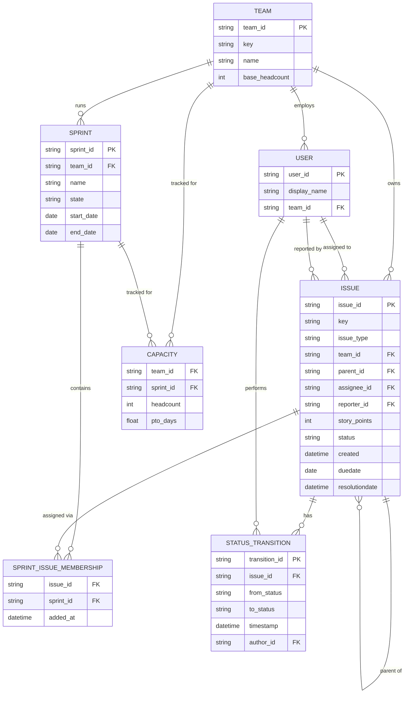

# Domain Model — Agile Analytics Pipeline (AAP)

This document is the source of truth for the simulator's internal data model and how it maps to Jira's actual API contract. Read this before writing or modifying `simulator/`, `mock_api/`, or `ingestion/` code. See `docs/decision-log.md` for the higher-level project decisions this builds on.

## Core principle: ground truth vs. views

The simulator produces one rich, internally-consistent **ground truth** — every team, user, issue, transition, and sprint membership, fully known because the simulation controls it. The mock API does not store a second copy of this data in Jira's shape; instead, each endpoint is a **serializer function** that projects a slice of the ground truth into whatever a specific real Jira endpoint would return (e.g. `GET /issue/{key}`, `GET /issue/{key}/changelog`, the Sprint Report).

This means: build the simulator's internal model first, independent of any Jira JSON shape. Write the Jira-shaped serialization as a separate layer on top.

## Entities and relationships

### Relationships in plain language

This section says the same thing as the diagram above, in sentences — read this if the diagram's notation (`||--o{` etc.) isn't obvious at a glance. "One-to-many" below means: one row on the left can relate to many rows on the right, but each row on the right points back to exactly one row on the left.

- **A TEAM has many USERs.** Every user belongs to exactly one team.
- **A TEAM runs many SPRINTs.** A sprint belongs to exactly one team.
- **A TEAM owns many ISSUEs.** Every issue belongs to exactly one team.
- **A TEAM has many CAPACITY records over time** (one per sprint it runs).
- **A SPRINT has many CAPACITY records** — in practice exactly one per sprint (a sprint's headcount/PTO snapshot), but modeled as one-to-many rather than one-to-one in case a later version wants to track a mid-sprint capacity correction.
- **A SPRINT contains many issues, through SPRINT_ISSUE_MEMBERSHIP** — this is a *join table*: it doesn't link SPRINT directly to ISSUE, it links each one to a SPRINT_ISSUE_MEMBERSHIP row instead, because that row needs to carry its own extra fact (`added_at` — when the issue joined). The schema permits an issue to be a member of more than one sprint over its lifetime (e.g. rolling an unfinished ticket into the next sprint) — nothing currently prevents this — but no generator process creates that today; every issue in the current simulation belongs to at most one sprint. This is schema flexibility for a possible future extension, not current behavior. A sprint obviously contains many issues.
- **An ISSUE has many STATUS_TRANSITIONs** — one row per status change (To Do → In Progress, In Progress → Code Review, etc.). This is the full history; `Issue.status` itself only ever holds the *current* status as a convenience.
- **An ISSUE can be the parent of many other ISSUEs** — this is the Epic → Story and Story → Task/Bug relationship, and it points back to the *same* entity (a "self-relationship"). An issue has at most one parent, but a parent can have many children.
- **A USER can perform many STATUS_TRANSITIONs** — this is "who moved this ticket," tracked via `author_id` on each transition row.
- **A USER can be the assignee on many ISSUEs** — "who is currently working this ticket," via `Issue.assignee_id`.
- **A USER can be the reporter on many ISSUEs** — "who originally filed this ticket," via `Issue.reporter_id`. This is a *separate* relationship from assignee — the same user can, and often does, show up as both the assignee on some issues and the reporter on others, but on any single issue those two fields can hold different users (or the same one).

## Entity notes

### TEAM (~ Jira Project)
One Jira "project" per team. `base_headcount` is simulator-internal only — Jira has no concept of headcount, which is exactly the gap this project fills.

### USER
Maps to Jira's `accountId` / `displayName` on `assignee`, `reporter`, and changelog `author`. Each user belongs primarily to one team for simulation purposes.

### SPRINT
Maps to the sprint object embedded in Jira's custom field array (e.g. `customfield_10020`). Note: `committed_points`, `completed_points`, and `scope_added_points` are **not** stored fields here — they're computed from `SPRINT_ISSUE_MEMBERSHIP` + `STATUS_TRANSITION`, the same way Jira's own Sprint Report computes them.

### ISSUE
Maps to `fields.*` on a Jira issue payload. Key points:
- `parent_id` is self-referential, modeling Jira's Epic Link concept — a simplification of Jira's real split between `parent` (subtasks) and the Epic Link custom field, made deliberately for v1. Currently only Epic→Story/Task/Bug links are generated (an Epic can be the parent of any issue type). Story→Task/Bug sub-linking (a Task belonging to a specific Story, independent of any Epic) is schema-supported — the field itself imposes no restriction — but no generator process creates this today; it's a possible future extension, not a current behavior.
- `story_points`: see the "Story points by issue type" decision below.
- `status` here is the issue's **current** status (a denormalized convenience); the authoritative history lives in `STATUS_TRANSITION`.
- `created` and `resolutiondate` are `datetime` (not `date`): they need full timestamp precision for cycle-time calculations, since `STATUS_TRANSITION.timestamp` is datetime-precision and Issue's own created/resolutiondate must match it or cycle-time math would silently lose precision. `duedate` stays `date`, since real Jira's duedate genuinely has no time component.

### STATUS_TRANSITION
The fact-table grain. Maps to one entry in `changelog.histories[].items[]` where `field == "status"`. One row per status change, with a timestamp — this is what makes cycle-time and time-in-status questions answerable.

### SPRINT_ISSUE_MEMBERSHIP
Added during domain modeling — not in the original skeleton. Tracks when an issue joined a sprint (`added_at`). Without this, "committed vs. completed vs. scope-added" (business question inputs) cannot be computed: you'd only know an issue's current sprint, not whether it was there from day one or added mid-sprint. This is the internal equivalent of what Jira's Sprint Report computes on the fly.

### CAPACITY
Tied to both TEAM and SPRINT — a capacity record is "this team, in this specific sprint, had this many people available" (`headcount`, `pto_days`). It's deliberately **not** connected to any Jira-side entity (Issue, StatusTransition, etc.) — see the ingestion note below for why it's ingested through a separate path from the Jira-shaped data, even though it relates to Team and Sprint just like the rest of the model.

## Story points by issue type (decision)

- **Epic**: no direct `story_points` field. If shown at all, it's a rollup (sum) of child stories' points — computed, not stored.
- **Story**: primary point-bearing unit. Required.
- **Task**: has `story_points`, following common team convention for standalone backlog tasks.
- **Bug**: **decided to carry `story_points` and count toward velocity** (rather than the stricter Scrum-purist convention of leaving bugs unpointed). Rationale: more realistic — most real teams do this — and it makes the "velocity vs. capacity" story richer, since a bug-heavy sprint will visibly show reduced "new value" velocity even at full capacity.

## Jira API realism decision: story points as a real field vs. `customfield_XXXXX`

Real Jira exposes story points as an opaque custom field (e.g. `customfield_10016`), since story points aren't a native Jira concept. For maximum mock-API fidelity, the mock API's JSON should use `customfield_XXXXX` naming, and the **ingestion client** should be responsible for mapping it to a clean internal field — this mapping step is itself realistic, defensible engineering (real Jira integrations always have to do this). Simplifying to a clean `story_points` key directly in the mock API is an acceptable v1 shortcut, but if taken, state it as a simplification if asked in an interview — same honesty standard as the other decisions in the project log.

## Where "commit vs. completion vs. scope-added" actually comes from

These numbers are **not** native fields on a Sprint object in real Jira — they're computed by Jira's Sprint Report, by comparing which issues were in the sprint at start vs. end. That report endpoint is part of the (semi-legacy, less formally documented) Jira Software API — worth a dedicated fidelity check later if exact field names matter. Conceptually, in this project:

- **Committed** = sum of `story_points` for issues where `SPRINT_ISSUE_MEMBERSHIP.added_at` is at/before sprint start
- **Scope added** = sum of `story_points` for issues where `added_at` is after sprint start
- **Completed** = sum of `story_points` for issues whose `resolutiondate` is set and falls on or before sprint end. (In implementation, this reads the denormalized `Issue.resolutiondate` field directly rather than querying `STATUS_TRANSITION` history — equivalent in practice, since `resolutiondate` is only ever set at the same instant the "→ Done" transition is recorded, but worth naming accurately since it's a real implementation choice, not just a conceptual shorthand.)

`sprint_report.py`'s actual output also includes `hit` (whether `completed >= committed` for that sprint — see the Block 5 decision log entry below) and a per-sprint bug count / total issue count, used for the bug-ratio business question. These aren't part of the three core formulas above but are computed alongside them.

## Ingestion split: Jira-shaped data vs. Capacity data (decision)

This is the key architectural asymmetry in the pipeline:

- **Jira-shaped data (Team, User, Sprint, Issue, StatusTransition)** must be faithful to a **real, external contract** — that fidelity is the actual engineering skill being demonstrated (see decision log 5.5). It goes through the mock API, shaped like real Jira REST responses.
- **Capacity data has no real universal contract to be faithful to** — every company tracks headcount/PTO differently (HR tool, spreadsheet, a side table in some other system). There's nothing to reverse-engineer, so this is a free, deliberate design choice rather than a fidelity requirement.

**Decided approach:** serve Capacity through its own small, custom REST endpoint (e.g. `GET /capacity?team=X&sprint=Y`), separate from the Jira-shaped mock API, with its own simple schema of our own design (not modeled on any real product). This keeps the ingestion layer architecturally symmetric — two clients, two APIs, same pattern — rather than mixing an API client with a flat-file reader.

*(Alternative considered: serve Capacity as a flat CSV instead, which is arguably just as realistic since many real companies do track capacity this way. Rejected in favor of the REST approach for pipeline consistency, but noted here as a legitimate alternative if revisited.)*

## Simulator simplification: committed work starts all at once (decision)

Sprint planning releases all committed work simultaneously at sprint start, rather than staggering it gradually. This creates a predictable early-sprint queue — developers near 100% utilized in the first ~2 days, tapering to ~43% by sprint end — that accounts for part of the low capacity-realization factor in `sprint_cycle.py`: some of that factor compensates for this start-of-sprint burst rather than purely for real-world overhead like rework and scope creep. Diagnosed via direct developer-pool sampling across a 12-sprint run. Not fixed in v1, since it doesn't affect the correctness of committed/completed/scope-added calculations, only the shape of within-sprint utilization. A v1.1 improvement would stagger committed-issue start times with a small random delay to spread the release instead of firing all at once.

## Open items carried over from this modeling pass

- Exact Sprint Report field names (Jira Software API) — verify later if fidelity matters for the mock API's sprint-report endpoint.
- Whether `reporter_id` and `priority` are worth modeling for v1 — currently included in the schema for realism but not required by any of the six confirmed business questions.