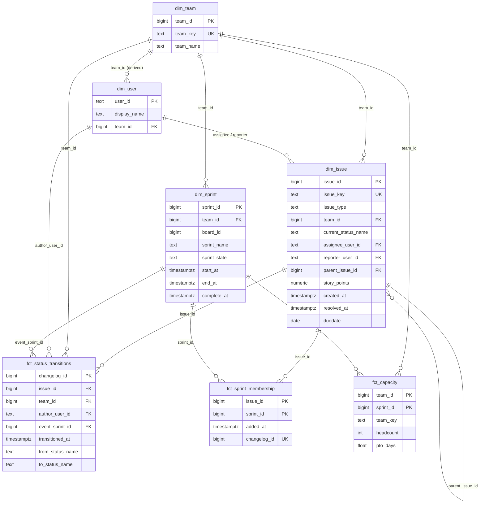

# 03. dbt star schema

Status: done (Session 3, [`../etl-plan.md`](../etl-plan.md)).

- **Step 3.1:** the dbt project, the profile, the staging sources and the 8 `stg_` views.
- **Step 3.2:** the four dimensions in `marts`, with unique, not null, accepted-value and relationship tests.
- **Step 3.3:** the three facts, with relationship, accepted-value, composite-grain and window tests.
- **Step 3.4:**
  - row-count, story point and one-team-per-user tests;
  - the sprint `complete_at` and state reconciliation with `raw_data/`;
  - this page's diagram, grain table, test list and limits.

## Purpose

Turns the typed staging mirror ([02-staging.md](02-staging.md)) into a star schema that Session 4's metrics and the dashboard read. dbt Core runs the SQL models in dependency order and holds the data tests next to them ([D-005](../decisions.md#d-005-locked-stack)).

The layers:

| Layer | Schema | Materialized as | What it does |
|---|---|---|---|
| Sources | `staging` | tables, loaded by `ingestion.load_staging` | not built by dbt, only declared |
| `stg_` models | `stg` | views, one per staging table | rename to one naming convention, nothing else |
| Dimensions and facts | `marts` | tables | the star schema |

## Inputs and outputs

**Inputs**

- The 8 tables in schema `staging`, declared as the dbt source `staging` (`dbt/models/staging/_staging__sources.yml`).
- `POSTGRES_HOST`, `POSTGRES_PORT`, `POSTGRES_USER`, `POSTGRES_PASSWORD`, `POSTGRES_DB`, read by `dbt/profiles.yml` with `env_var()` and no defaults ([D-026](../decisions.md#d-026-dbt-core-112-with-dbt-postgres-111-in-dbt-profile-from-the-environment)).

**Outputs**

- Schema `stg`: 8 views, replaced by every `dbt build` or `dbt run`. They read staging live, so they show the current rows right after a reload with no dbt run.
- Schema `marts`: 4 dimension and 3 fact tables, replaced by every `dbt build` or `dbt run`.
- `dbt/target/` (compiled SQL, `manifest.json`, run results) and `dbt/logs/`, both gitignored.

## Schema or contract

**The star schema in `marts`.** Each line is a key that a `relationships` test checks. Every key is a natural Jira key ([D-028](../decisions.md#d-028-star-schema-with-natural-keys-and-no-date-dimension)).



The diagram leaves out `current_status_id`, `summary` and the status IDs on the transition fact. The tables below list every column.

**Grain of each table**

| Table | Kind | One row per | Key | Rows (SEED=22) |
|---|---|---|---|---|
| `dim_team` | dimension | team (Jira project) | `team_id` | 3 |
| `dim_user` | dimension | Jira account | `user_id` | 12 |
| `dim_sprint` | dimension | sprint | `sprint_id` | 36 |
| `dim_issue` | dimension | issue, at its current status | `issue_id` | 530 |
| `fct_status_transitions` | fact | status change | `changelog_id` | 1,488 |
| `fct_sprint_membership` | fact | issue joining a sprint | (`issue_id`, `sprint_id`) | 320 |
| `fct_capacity` | fact | team and sprint | (`team_id`, `sprint_id`) | 36 |

**Schema names** ([D-027](../decisions.md#d-027-two-dbt-layers-with-exact-schema-names-stg-views-and-marts-tables)). dbt's built-in `generate_schema_name` would return `<profile schema>_<custom schema>`, for example `marts_stg`. `dbt/macros/generate_schema_name.sql` returns the custom schema as is. So `+schema: stg` (set for `models/staging/` in `dbt_project.yml`) builds into `stg`. A node with no custom schema falls back to the profile's `marts`.

The macro and the source also read two vars, both used only by the tests:

- `schema_suffix` (default empty) is appended to every built schema;
- `staging_schema` (default `staging`) is the source schema.

With `{staging_schema: staging_test, schema_suffix: _test}`, dbt reads `staging_test` and builds `stg_test` and `marts_test`.

**`stg_` views.** One per staging table, named `stg_<table>`. Each one renames keys to `<entity>_id` and keeps every other column as it is, `_source_file` and `_loaded_at` included.

| View | Renamed columns | Rows (SEED=22) |
|---|---|---|
| `stg_teams` | `project_id` → `team_id`, `project_key` → `team_key`, `project_name` → `team_name` | 3 |
| `stg_users` | `account_id` → `user_id` | 12 |
| `stg_boards` | `project_id` → `team_id`, `project_key` → `team_key` | 3 |
| `stg_sprints` | `state` → `sprint_state` | 36 |
| `stg_capacity` | none (`team_key` is a project key, as in `/capacity`) | 36 |
| `stg_issues` | `project_id` → `team_id`, `assignee_account_id` → `assignee_user_id`, `reporter_account_id` → `reporter_user_id` | 530 |
| `stg_status_transitions` | `author_account_id` → `author_user_id` | 1,488 |
| `stg_sprint_memberships` | none | 320 |

**Dimensions** (schema `marts`, tables, rebuilt by every `dbt build`). Keys are natural Jira keys, with no surrogate keys ([D-028](../decisions.md#d-028-star-schema-with-natural-keys-and-no-date-dimension)).

| Table | Grain and key | Columns | Built from | Rows |
|---|---|---|---|---|
| `dim_team` | one row per team; `team_id` (Jira project ID) | `team_key` (unique, used by capacity), `team_name` | `stg_teams` | 3 |
| `dim_user` | one row per Jira account; `user_id` | `display_name`, `team_id` | `stg_users`, team from `stg_issues` | 12 |
| `dim_sprint` | one row per sprint; `sprint_id` | `team_id`, `board_id`, `sprint_name`, `sprint_state`, `start_at`, `end_at`, `complete_at` | `stg_sprints`, team from `stg_boards` by `board_id` | 36 |
| `dim_issue` | one row per issue; `issue_id` | `issue_key` (unique), `issue_type`, `team_id`, `current_status_id`, `current_status_name`, `assignee_user_id`, `reporter_user_id`, `parent_issue_id`, `story_points`, `created_at`, `resolved_at`, `duedate`, `summary` | `stg_issues` | 530 |

- **A user's team** ([D-029](../decisions.md#d-029-a-users-team-is-derived-from-the-issues-assigned-to-them)). `dim_user.team_id` is the team of the issues assigned to the user when there is exactly one such team, and null otherwise. A `not_null` test on it then fails. So a user assigned issues in two teams, or in none, is reported, never resolved by picking one. In the shipped data each user maps to one team: Phoenix 5, Nomad 4, Atlas 3, the simulator's headcounts. A test checks the derived team against `raw_data/users.json`.
- **Boards** are not a dimension. In v1 each team has one board, and the board only links a sprint to its team, so `dim_sprint` carries `board_id` and the board's `team_id`.
- **Status on `dim_issue`** is the current status, renamed `current_status_*` so it is not confused with the transition history (step 3.3).

Generic tests take their arguments under `arguments:`, the dbt 1.10+ form, so dbt raises no deprecation warning.

**Facts** (schema `marts`, tables).

| Table | Grain and key | Columns | Built from | Rows |
|---|---|---|---|---|
| `fct_status_transitions` | one row per status change; `changelog_id` | `issue_id`, `team_id` (the issue's), `author_user_id`, `event_sprint_id`, `transitioned_at`, `from_status_id`, `from_status_name`, `to_status_id`, `to_status_name` | `stg_status_transitions`, `stg_issues`, `dim_sprint` | 1,488 |
| `fct_sprint_membership` | one row per issue joining a sprint; (`issue_id`, `sprint_id`) | `added_at`, `changelog_id` (unique) | `stg_sprint_memberships` | 320 |
| `fct_capacity` | one row per team and sprint; (`team_id`, `sprint_id`) | `team_key`, `headcount`, `pto_days` | `stg_capacity`, `team_id` from `dim_team` by `team_key` | 36 |

**`event_sprint_id`** ([D-030](../decisions.md#d-030-a-transitions-sprint-is-the-window-it-happened-in-event_sprint_id)) is the sprint of the issue's team whose window contained the transition.

- **The window** is half-open, `start_at <= transitioned_at < end_at`. One sprint's `end_at` is the next one's `start_at`, so a boundary instant belongs to the later sprint only.
- **Not the issue's sprint.** That stays in `fct_sprint_membership`.
- **Left joins.** The fact uses left joins, so a transition with no issue or no window keeps its row with a null key, which fails a test.

**Where `event_sprint_id` differs from the membership sprint.** Measured on the shipped data before the fact was built: 216 of the 1,488 transitions, all of them on the 320 scheduled issues. The 180 never-scheduled issues have no transitions.

| Category | Transitions | Issues |
|---|---|---|
| After the membership sprint ended | 216 | 66 |
| Before the issue joined its sprint | 0 | 0 |
| Before the membership sprint started | 0 | 0 |
| In a gap (no window) or two windows | 0 | 0 |

The 216, cut other ways:

- **How far:** 208 land in the next sprint and 8 (4 issues) two sprints later.
- **To status:** QA 70, Done 65 (65 issues), Code Review 61, In Progress 20. So 65 of the 66 issues reached Done in a later sprint.
- **Membership:** 138 transitions belong to scope-added issues (39) and 78 to committed ones (27).
- **Team:** PHX 100 (30 issues), NMD 59 (18), ATL 57 (18).
- **Type:** Story 112, Task 66, Bug 38.

This is the "no carryover" v1 limitation ([`../domain-model.md`](../domain-model.md), "Known v1 limitations"): an unfinished issue stays a member of its original sprint while its work continues in the next one. Nothing in the breakdown was unexpected.

## How to run

From the repo root, with Postgres up and staging loaded ([02-staging.md](02-staging.md#how-to-run)):

```bash
uv run --env-file .env dbt debug --project-dir dbt --profiles-dir dbt   # profile and connection check
uv run --env-file .env dbt build --project-dir dbt --profiles-dir dbt   # build every model and run its tests
```

The subcommand comes before the flags (`dbt build --project-dir ...`). Flags placed before it are refused, with exit code 2.

After `ingestion.load_staging`, no dbt run is needed for the `stg_` views: they read the reloaded tables. The `marts` tables need `dbt build` again.

**`.env` is also read by dbt itself.** dbt-core 1.12 loads `.env` from the working directory or a parent, without overriding variables already set ([D-026](../decisions.md#d-026-dbt-core-112-with-dbt-postgres-111-in-dbt-profile-from-the-environment)). From the repo root, a command without `--env-file .env` still connects. The documented command keeps the flag, so it works the same where there is no `.env`, as in CI.

## How it is verified

### dbt tests

`uv run --env-file .env dbt test --project-dir dbt --profiles-dir dbt`: 74 tests. `dbt build` runs them too, each one after the model it checks. The generic tests are in `dbt/models/marts/_marts__dimensions.yml` and `_marts__facts.yml`. The singular tests and the two generic test macros are in `dbt/tests/`.

| Kind | Count | What is tested |
|---|---|---|
| `unique` | 8 | every single-column key: `team_id`, `team_key`, `user_id`, `sprint_id`, `issue_id`, `issue_key`, and `changelog_id` on both changelog facts |
| `unique_combination` (own generic, [D-031](../decisions.md#d-031-no-dbt-packages-in-v1)) | 2 | (`issue_id`, `sprint_id`) on `fct_sprint_membership`, (`team_id`, `sprint_id`) on `fct_capacity` |
| `not_null` | 33 | every key and foreign key, the names, `issue_type`, `current_status_name`, every timestamp a metric needs, `headcount`, `pto_days`, and both derived team IDs (user and sprint) |
| `relationships` | 14 | every line in the diagram (assignee / reporter is two) |
| `accepted_values` | 5 | `issue_type` (Epic, Story, Task, Bug); `sprint_state` (future, active, closed); `current_status_name`, `from_status_name` and `to_status_name` (the five fixed statuses) |
| `expected_row_count` (own generic) | 7 | each `marts` table has its shipped count: 3, 12, 36, 530, 1,488, 320, 36 |
| singular | 5 | see below |

Singular tests return the offending rows, so a failure shows what is wrong:

- **`assert_each_transition_in_exactly_one_sprint_window`.** Every transition matches exactly one window of its team. 0 means a gap, 2 means overlapping sprints.
- **`assert_transitions_join_every_dimension_once`.** The inner join of the transition fact to all four dimensions has as many rows as the fact.
- **`assert_fact_teams_match_their_sprint`.** A membership's issue and sprint share a team, and so do a capacity row and its sprint.
- **`assert_story_points_null_exactly_for_epics`.** Every non-Epic issue has story points, and no Epic has any ([D-010](../decisions.md#d-010-bugs-carry-story-points-and-count-toward-velocity)).
- **`assert_each_user_assigned_issues_in_one_team`.** Every user is assigned issues in exactly one team, and a failure lists the teams found. It reads the `stg` layer, independently of how `dim_user` derives the team ([D-029](../decisions.md#d-029-a-users-team-is-derived-from-the-issues-assigned-to-them)).

Two choices in the tests:

- `author_user_id` is `not_null`, although Jira allows a null author (automation). The shipped data has none, and a null would drop the row from the inner join to `dim_user`.
- The count targets are the SEED=22 shipped dataset's. A new seed means new targets, here and in CLAUDE.md.

### Sprint `complete_at` and state against `raw_data/`

This check was carried over from Session 2. It lives in `tests/test_staging_reconciliation.py`, the independent reconciliation ([02-staging.md](02-staging.md#reconciliation-with-raw_data-step-23)), not in dbt, because the expected side is read from `raw_data/*.json`.

- **No raw counterpart.** `raw_data/sprints.json` has no completion field: only `state`, `start_date` and `end_date`. The mock API's rule (`mock_api/serializers.py`, `_sprint_dates`) is that a closed sprint was completed at its scheduled end. The test restates that rule rather than importing it.
- **Expected value:** `end_date` at 09:00 UTC when `state` is `closed`, otherwise null. It is compared exactly, as part of the sprint row (team, name, state, start, end, complete).
- **State.** The sprint's state (closed, active, future) is compared in the same row. All 36 are closed in the shipped data.
- **Sabotage 3:** moving one sprint's `complete_at` by 1 ms, or setting its state to `active`, fails exactly the `sprints` table on that one sprint. A reload passes again.

### pytest

`uv run --env-file .env python -m pytest tests/test_dbt.py -rs`: 19 tests, 0 skipped.

- **Isolation.** The Postgres tests load staging into `staging_test` and run dbt with the test vars, so dbt builds `stg_test` (and later `marts_test`). All three schemas are dropped before and after, and `staging`, `stg` and `marts` are never touched. dbt's target and log files go to a temporary directory.
- **No `.env`.** dbt runs from that temporary directory, so it finds no `.env` and depends on the process environment alone.
- **Built once for the tests that only read** (step 5.2, [D-045](../decisions.md#d-045-tests-that-only-read-share-one-warehouse-built-once)). The dimension, fact and window tests read `built_warehouse` (`tests/conftest.py`): the same schemas, built once, in a database of their own, through a read-only connection. Every test that changes data keeps the `warehouse` fixture and its own schemas.
- **Sabotage runs** use `dbt run`, then `dbt test`, and compare the exact set of failed tests. `dbt build` skips everything downstream of a failing test. For example, a failed window test stops `fct_status_transitions` from being built, which is what the pipeline wants, but it would hide the other tests a sabotage should fail.

| Test | What it proves |
|---|---|
| `test_profile_takes_every_connection_value_from_the_environment` | host, port, user, password and dbname in `dbt/profiles.yml` are all `env_var('POSTGRES_*')`. |
| `test_dbt_debug_connects_with_the_environment` | `dbt debug` passes ("All checks passed!"). |
| `test_sabotage_a_wrong_credential_fails_dbt_debug_clearly` | **Sabotage:** a wrong `POSTGRES_PASSWORD` fails `dbt debug` with `password authentication failed`. Removing `POSTGRES_HOST` fails it with `Env var required but not provided: 'POSTGRES_HOST'`. |
| `test_stg_views_build_count_and_survive_a_staging_reload` | `dbt run --select staging` creates exactly the 8 views, with the shipped counts. After a normal `load_staging`, the views are the same objects (same oids) with the same counts. |
| `test_dbt_never_writes_outside_the_test_schemas` | With the test vars, every `staging/` model is in `stg_test`, every `marts/` model in `marts_test`, and the source in `staging_test`. |
| `test_the_shared_warehouse_refuses_writes` | The shared build's connection rejects a delete, so a test on it can only read. |
| `test_dimensions_build_with_the_shipped_counts_and_pass_their_tests` | A full `dbt build` passes with no failed test. The dimensions are tables with 3, 12, 36 and 530 rows. |
| `test_derived_user_teams_equal_raw_data` | Each user's derived team is their team in `raw_data/users.json`, matched by display name and team key. |
| `test_sabotage_a_deleted_staging_user_fails_the_user_relationships` | **Sabotage:** deleting "Phoenix Dev 1" from staging fails exactly the tests pointing at `dim_user`: issue assignee and reporter, transition author, the join to every dimension, and `dim_user`'s row count. After a reload, the build passes. |
| `test_sabotage_a_duplicated_staging_user_fails_unique` | **Sabotage:** staging's primary key refuses a duplicate user (`UniqueViolation`). With the key dropped, a duplicated row fails exactly three tests: `unique_dim_user_user_id`, the join test (that user's transitions double) and `dim_user`'s row count. |
| `test_sabotage_a_user_in_two_teams_fails_the_team_mapping` | **Sabotage:** moving one PHX issue to ATL gives its assignee two teams. Exactly three tests fail: `not_null_dim_user_team_id`, `assert_each_user_assigned_issues_in_one_team`, and `assert_fact_teams_match_their_sprint`, since the issue's PHX sprint membership now crosses teams. |
| `test_facts_build_with_the_shipped_counts_and_join_all_four_dimensions` | The facts have 1,488, 320 and 36 rows. The inner join to all four dimensions gives 1,488 rows and 1,488 distinct IDs. |
| `test_event_sprint_is_the_window_that_contains_the_transition` | `event_sprint_id` differs from the membership sprint on exactly 216 transitions, and for every one of them both the transition and its event sprint come after the membership sprint ended. |
| `test_a_transition_on_a_sprint_boundary_belongs_to_the_later_sprint` | A transition moved to exactly PHX Sprint 6's `start_at` (= Sprint 5's `end_at`) gets Sprint 6, and every test passes. Since step 4.3, the moved transition belongs to a PHX issue created before that instant: the first pick, PHX-138, was created four days after it, an impossible history that the Q4 stay test rejects. |
| `test_sabotage_an_orphan_transition_fails_the_issue_relationship` | **Sabotage:** a transition with issue ID 999999999 fails the `issue_id` relationship test. So do the checks that need its issue: `not_null` on `team_id` and `event_sprint_id`, the window test, the join test and the fact's row count. Six in all, nothing else. |
| `test_sabotage_overlapping_sprints_fail_the_window_test` | **Sabotage:** PHX Sprint 5 ending a day late overlaps Sprint 6. Exactly three tests fail: the window test, `unique` on `changelog_id` and the fact's row count, since the overlapping day's transitions match two sprints. Since step 4.3, two metric tests fail too: the Q4 stay count (the duplicated transitions add stays) and the Q5 period check (issues created that day fall in two periods). |
| `test_sabotage_a_null_key_fails_not_null` | **Sabotage, null key:** staging refuses a null `changelog_id` (`NotNullViolation`). With its primary key and not null constraint dropped, one null key fails exactly `not_null_fct_status_transitions_changelog_id`. |
| `test_sabotage_a_duplicate_key_fails_unique_and_the_row_count` | **Sabotage, duplicate key:** with staging's primary key dropped, one transition copied in full fails exactly three tests: `unique_fct_status_transitions_changelog_id`, `expected_row_count_fct_status_transitions_1488` (1,489 rows) and the window test (that `changelog_id` counts two windows). Since step 4.3, the Q4 stay count fails too (the copy adds a stay). |
| `test_sabotage_an_epic_with_story_points_fails_the_story_point_test` | **Sabotage:** giving one Epic 3 story points fails exactly `assert_story_points_null_exactly_for_epics`. |

**Gate run for step 3.1**, on the real schemas, through the documented commands:

- **`dbt debug`:** "All checks passed!", exit 0.
- **`dbt build`:** `PASS=8 WARN=0 ERROR=0`. The 8 views are in `stg`.
- **Counts through the views:** 3 teams, 12 users, 3 boards, 36 sprints, 36 capacity, 530 issues, 1,488 transitions, 320 memberships.
- **Reload:** after `uv run --env-file .env python -m ingestion.load_staging`, the view names, oids and counts are identical.
- **Sabotage:**
  - `POSTGRES_PASSWORD=wrong` gives `Connection test: [ERROR]` and `password authentication failed for user "aap"`, exit 1.
  - Without `POSTGRES_HOST`, run outside the repo, it gives `Env var required but not provided: 'POSTGRES_HOST'`, exit 2.

**Gate run for step 3.2**, on the real schemas:

- **`dbt build`:** `PASS=43 WARN=0 ERROR=0` (8 views, 4 tables, 31 tests).
- **Counts:** `dim_team` 3, `dim_user` 12, `dim_sprint` 36, `dim_issue` 530. Every key is unique and not null, and every relationship holds.
- **Teams:** 0 users without exactly one team.
- **Sabotage, delete:** after deleting "Atlas Dev 2" from `staging.users`, `dbt build` fails exactly two tests:
  - `relationships_dim_issue_assignee_user_id__user_id__ref_dim_user_`, with 31 rows;
  - `relationships_dim_issue_reporter_user_id__user_id__ref_dim_user_`, with 39 rows.
- **Sabotage, duplicate:**
  - On the real `staging`, inserting a copy of a user row is refused: `duplicate key value violates unique constraint "users_pkey"`.
  - The pytest case above drops that key in `staging_test` and shows `unique_dim_user_user_id` failing.
- **Restore:** `load_staging`, then `dbt build`: `PASS=43` again.

**Gate run for step 3.3**, on the real schemas:

- **`dbt build`:** `PASS=80 WARN=0 ERROR=0` (8 views, 7 tables, 65 tests).
- **Counts:** `fct_status_transitions` 1,488, `fct_sprint_membership` 320, `fct_capacity` 36.
- **Join:** the inner join of the transition fact to `dim_issue`, `dim_team`, `dim_user` and `dim_sprint` returns 1,488 rows and 1,488 distinct `changelog_id`s. No rows are lost and none are duplicated.
- **Sabotage, orphan row:**
  - A copy of a transition with `issue_id` 999999999 was inserted into `staging.status_transitions`.
  - `dbt run` then `dbt test` gives `ERROR=5`: `relationships_fct_status_transitions_issue_id__issue_id__ref_dim_issue_`, `not_null_fct_status_transitions_team_id`, `not_null_fct_status_transitions_event_sprint_id`, `assert_each_transition_in_exactly_one_sprint_window` and `assert_transitions_join_every_dimension_once`, each with 1 row.
- **Restore:** `load_staging`, then `dbt build`: `PASS=80`.

The 3.2 and 3.3 gate runs above list the failures as they were at the time. Since step 3.4, the same sabotage also fails the row-count test or the one-team test where the table above says so.

**Gate run for step 3.4:**

- **dbt, on the real schemas:**
  - `dbt build` gives `PASS=89 WARN=0 ERROR=0` (8 views, 7 tables, 74 tests).
  - `dbt test` in full gives `PASS=74 WARN=0 ERROR=0`.
- **Sabotage, each failing the right test** (pytest, on the test schemas):
  - null key → `not_null_fct_status_transitions_changelog_id` only;
  - duplicate key → `unique_fct_status_transitions_changelog_id`, the row count (1,489) and the window test;
  - changed `complete_at` → the reconciliation's `sprints` table only;
  - also a changed state, an Epic with story points, and the earlier cases.
- **`complete_at` on the real `staging`:**
  - The reconciliation, run read-only, finds no difference in any table, sprint `complete_at` and state included.
  - Moving NMD Sprint 3's `complete_at` by 1 ms gives a mismatch in `sprints` only: the expected row is missing and the changed one is extra.
  - After `load_staging`, there are no differences again.
- **Full suite and hooks:** see the session report. `pytest -rs` passes with 0 skipped, and `sh scripts/test_hooks.sh` gives 28 passed, 0 failed.

## Known limits

- **Global schema names.** `stg` and `marts` have no per-developer or per-target prefix, so two people sharing a database would overwrite each other's models ([D-027](../decisions.md#d-027-two-dbt-layers-with-exact-schema-names-stg-views-and-marts-tables)).
- **dbt reads `.env` on its own** from the working directory. A missing variable can be filled from a file the command doesn't name ([D-026](../decisions.md#d-026-dbt-core-112-with-dbt-postgres-111-in-dbt-profile-from-the-environment)).
- **`complete_at` is derived, and no metric uses it.** `raw_data/` has no completion instant, so a closed sprint's `complete_at` is its scheduled end, by the mock API's rule. Its reconciliation only shows that staging follows that rule. Sprint metrics use `end_at` (the sprint's `end_date` at 09:00 UTC), never `complete_at` ([D-032](../decisions.md#d-032-sprint-complete_at-is-reconciled-against-a-derived-value)).
- **`event_sprint_id` needs contiguous sprints.** A transition before the first sprint, after the last one, or in a gap gets no sprint. It fails `not_null` and the window test rather than being dropped. The shipped data has none ([D-030](../decisions.md#d-030-a-transitions-sprint-is-the-window-it-happened-in-event_sprint_id)).
- **One team per user, one board per team.** Both are v1 assumptions. Each is checked by a test, not modeled ([D-029](../decisions.md#d-029-a-users-team-is-derived-from-the-issues-assigned-to-them)).
- **Automation authors.** A transition with no author fails `not_null`. Real Jira can have them, so supporting them would mean an "automation" user or left joins in the reports.
- **Row-count targets are dataset-specific.** `expected_row_count` holds the SEED=22 counts.
- **No date dimension.** Power BI will need a date table for calendar slicing ([D-028](../decisions.md#d-028-star-schema-with-natural-keys-and-no-date-dimension)).
- **`dbt build` stops at a failing test.** Everything downstream of it is skipped. That is the right behavior for the pipeline, but one run shows only the first layer of failures. For a full picture, run `dbt run`, then `dbt test`.
- **A staging schema change needs the views rebuilt.** `load_staging --rebuild` refuses while the `stg_` views depend on staging ([D-022](../decisions.md#d-022-staging-reloads-by-truncate-and-copy-drop-and-recreate-only-on---rebuild)). Drop the `stg` schema first, rebuild, then `dbt build`.

## Options rejected and why

- **dbt v2, dbt-core 1.13 (beta), a profile in `~/.dbt/`, literal or defaulted credentials:** [D-026](../decisions.md#d-026-dbt-core-112-with-dbt-postgres-111-in-dbt-profile-from-the-environment).
- **dbt's default schema concatenation, `stg_` as tables, tests on the real schemas or a second database:** [D-027](../decisions.md#d-027-two-dbt-layers-with-exact-schema-names-stg-views-and-marts-tables).
- **Surrogate keys and a date dimension:** [D-028](../decisions.md#d-028-star-schema-with-natural-keys-and-no-date-dimension).
- **A hand-written user-to-team mapping, or picking the most frequent team:** [D-029](../decisions.md#d-029-a-users-team-is-derived-from-the-issues-assigned-to-them).
- **The membership sprint on transitions, or a closed window:** [D-030](../decisions.md#d-030-a-transitions-sprint-is-the-window-it-happened-in-event_sprint_id).
- **dbt_utils, or `unique` on a concatenated expression:** [D-031](../decisions.md#d-031-no-dbt-packages-in-v1).
- **Leaving `complete_at` unchecked, or checking it in dbt:** [D-032](../decisions.md#d-032-sprint-complete_at-is-reconciled-against-a-derived-value).
