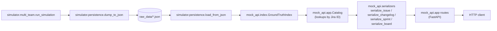

# Mock API reference

Single source of truth for what the Jira mock API does, what the test suite checks, and what is assumed. Every claim cites the code that implements it. Claims checked by the suite carry a row number from the [verification table](#7-verification-status), like **[V12]**. Anything labelled *assumed* is our own choice, not a fact about Jira.

Code paths are relative to the repository root. "app.py" means [`mock_api/app.py`](../mock_api/app.py) and "serializers.py" means [`mock_api/serializers.py`](../mock_api/serializers.py).

## 1. Overview

The mock API is a FastAPI server that answers seven Jira Cloud REST endpoints from the simulator's ground truth, plus one capacity endpoint of our own design ([section 11](#11-capacity-endpoint-our-own-design-not-an-atlassian-contract)). It exists so the ingestion layer can be built and tested against a realistic Jira contract without a Jira site.

What it is **not**:

- **Not a real Jira.** It implements a handful of read-only endpoints and a small JQL subset ([section 5](#5-supported-jql)). There are no writes, webhooks, permissions or projects beyond the three simulated teams.
- **Not authenticated.** Any non-empty `Basic` or `Bearer` credential is accepted (app.py, `require_authorization`). [V37]
- **Not real data.** Every team, user, issue and sprint is synthetic, produced by the seeded simulation in `simulator/`.

Where it fits, per [`docs/domain-model.md`](domain-model.md) ("Core principle: ground truth vs. views"):

1. **Simulator** (`simulator/`) produces the ground truth.
2. **Persistence** (`simulator/persistence.py`) writes it to `raw_data/` as seven JSON files.
3. **Mock API** (`mock_api/`) loads `raw_data/` once at startup and projects it into Jira response shapes on each request. It stores no Jira-shaped copy and never modifies the loaded entities. [V19]
4. **Ingestion** (`ingestion/extract.py`) calls these endpoints as it would a real Jira: the board list, each board's sprints, one `search/jql` per project, each issue's changelog, each sprint's issue list, and `/capacity`. It lands the raw pages in `landing/` ([`docs/etl/01-extraction.md`](etl/01-extraction.md)). It does not call `GET issue` or `GET sprint`.

## 2. Data flow



- `scripts/generate_raw_data.py` runs the first two steps.
- `app.py` `load_catalog` runs at startup, inside the `create_app` lifespan. It reads from the path in `AAP_RAW_DATA_DIR` if set, otherwise from `raw_data/` at the repository root (`DEFAULT_RAW_DATA_DIR`).
- If the directory or any of the seven entity files is missing, the app raises `RuntimeError` and refuses to start. The message names the fix (`python scripts/generate_raw_data.py`). [V42]
- `mock_api/jql.py` parses and applies the JQL subset. `mock_api/ids.py` derives every Jira ID (numeric IDs and `accountId`) by hashing the ground-truth ID.

## 3. Endpoint reference

All paths require an `Authorization` header ([section 6](#6-authentication-and-errors)). Base URLs inside payloads come from `BASE_URL = "http://localhost:8000"` in [`mock_api/config.py`](../mock_api/config.py). Timestamps are written as UTC with milliseconds: platform fields use `+0000` (serializers.py, `jira_datetime`), and sprint dates use `+00:00` (`agile_datetime`).

### 3.1 `GET /rest/api/3/issue/{issueIdOrKey}`

Implemented by app.py `get_issue`, which calls serializers.py `serialize_issue`.

| Parameter | Default | Behavior |
|---|---|---|
| `issueIdOrKey` (path) | — | All-digit values are looked up as the numeric Jira ID; anything else as an issue key, upper-cased first (`Catalog.issue`). [V29] |
| `fields` | all fields | Comma-separated and repeatable. A name selects that field, `*all` or `*navigable` selects all, and `-name` excludes one. Exclusions alone start from all fields. Unknown names are ignored (`project_fields`). [V30] |
| `expand` | none | Only `changelog` has an effect: it adds a `changelog` object, newest first, capped at `EMBEDDED_CHANGELOG_LIMIT = 100` histories. [V31] Other values are ignored. |

With no parameters, the response equals `serialize_issue`'s output exactly [V29], and every field reads back to the source entity [V2–V10]. Real response for `PHX-29`:

```json
{
  "id": "86877088",
  "key": "PHX-29",
  "self": "http://localhost:8000/rest/api/3/issue/86877088",
  "fields": {
    "summary": "Story PHX-29",
    "issuetype": {"self": "http://localhost:8000/rest/api/3/issuetype/10101", "id": "10101", "name": "Story", "subtask": false, "hierarchyLevel": 0},
    "project": {"self": "http://localhost:8000/rest/api/3/project/18405660", "id": "18405660", "key": "PHX", "name": "Phoenix", "projectTypeKey": "software", "simplified": false},
    "status": {"self": "http://localhost:8000/rest/api/3/status/10004", "id": "10004", "name": "Done"},
    "assignee": {"self": "http://localhost:8000/rest/api/3/user?accountId=44acdcc69d2d77d59f40e296", "accountId": "44acdcc69d2d77d59f40e296", "accountType": "atlassian", "displayName": "Phoenix Dev 5", "active": true},
    "reporter": {"self": "...", "accountId": "57d1870b2aa0b36f3728e8fc", "accountType": "atlassian", "displayName": "Phoenix Dev 1", "active": true},
    "created": "2024-01-25T11:10:00.767+0000",
    "duedate": "2024-02-16",
    "resolutiondate": "2024-02-12T13:11:43.221+0000",
    "customfield_10016": 3,
    "customfield_10020": [
      {"id": 89928328, "name": "Sprint 2", "state": "closed", "boardId": 66676782,
       "startDate": "2024-02-05T09:00:00.000+00:00", "endDate": "2024-02-19T09:00:00.000+00:00", "completeDate": "2024-02-19T09:00:00.000+00:00"}
    ],
    "parent": {
      "id": "29528245", "key": "PHX-21", "self": "http://localhost:8000/rest/api/3/issue/29528245",
      "fields": {"summary": "Epic PHX-21", "status": {"self": "...", "id": "10000", "name": "To Do"}, "issuetype": {"self": "...", "id": "10100", "name": "Epic", "subtask": false, "hierarchyLevel": 1}}
    }
  }
}
```

(`"..."` marks `self` URLs shortened for display.) Field rules, all in serializers.py `serialize_issue`:

- `customfield_10016` holds story points, and is `null` for Epics (`_story_points`). [V4]
- `customfield_10020` lists the issue's sprints, or is `null` if it has none (`_sprint_field_entry`). [V10]
- `parent` is present only for issues that have a parent; it is omitted, not null, otherwise (`_parent`). [V9]
- `duedate` is a plain date set by the simulator's deadline rule, and `null` for issues never in a sprint, including every Epic ([`docs/domain-model.md`](domain-model.md), "Deadline (duedate) rule"). [V43]
- Status IDs come from `STATUS_IDS` in config.py: To Do `10000`, In Progress `10001`, Code Review `10002`, QA `10003`, Done `10004`. [V1, V5]
- Issue type IDs come from `ISSUE_TYPES`: Epic `10100`, Story `10101`, Task `10102`, Bug `10103`. [V7]

With `expand=changelog`, the response gains `"changelog": {"startAt": 0, "maxResults": N, "total": N, "histories": [...]}`, where each history has the shape shown in 3.2.

**Errors:** 401 for a missing or bad `Authorization` header. 404 with `Issue does not exist or you do not have permission to see it.` for an unknown key or ID. [V37, V38]

### 3.2 `GET /rest/api/3/issue/{issueIdOrKey}/changelog`

Implemented by app.py `get_changelog`, which calls serializers.py `serialize_changelog`.

| Parameter | Default | Limits |
|---|---|---|
| `startAt` | `0` | must be ≥ 0, else 400 |
| `maxResults` | `100` (`DEFAULT_CHANGELOG_PAGE_SIZE`) | must be ≥ 1, else 400; no upper cap |

- **Contents:** one history per status transition and one per sprint membership, merged oldest first (`_histories_oldest_first`). [V11, V12]
- **Response:** equals `serialize_changelog`'s output. [V27]

Real first page for `PHX-29` with `maxResults=2`:

```json
{
  "self": "http://localhost:8000/rest/api/3/issue/PHX-29/changelog?startAt=0&maxResults=2",
  "maxResults": 2,
  "startAt": 0,
  "total": 5,
  "isLast": false,
  "values": [
    {"id": "97656248", "author": {"self": "http://localhost:8000/rest/api/3/user?accountId=57d1870b2aa0b36f3728e8fc", "accountId": "57d1870b2aa0b36f3728e8fc", "accountType": "atlassian", "displayName": "Phoenix Dev 1", "active": true}, "created": "2024-02-06T12:05:46.473+0000",
     "items": [{"field": "Sprint", "fieldtype": "custom", "fieldId": "customfield_10020", "from": "", "fromString": "", "to": "89928328", "toString": "Sprint 2"}]},
    {"id": "78787044", "author": {"self": "http://localhost:8000/rest/api/3/user?accountId=57d1870b2aa0b36f3728e8fc", "accountId": "57d1870b2aa0b36f3728e8fc", "accountType": "atlassian", "displayName": "Phoenix Dev 1", "active": true}, "created": "2024-02-06T16:22:16.652+0000",
     "items": [{"field": "status", "fieldtype": "jira", "fieldId": "status", "from": "10000", "fromString": "To Do", "to": "10001", "toString": "In Progress"}]}
  ],
  "nextPage": "http://localhost:8000/rest/api/3/issue/PHX-29/changelog?startAt=2&maxResults=2"
}
```

- **Status items:** carry status IDs in `from`/`to` and names in `fromString`/`toString`. The author is the transition's author. [V13] Replayed in order, they end at the issue's current status. [V14]
- **Sprint items:** the author is the issue's reporter, and `created` is the membership's `added_at` (`_sprint_history`). [V15] Every sprint membership can be rebuilt from these items alone. [V17]
- **Errors:** 401; 404 for an unknown issue; 400 for a bad `startAt` or `maxResults`. [V37–V39]

### 3.3 `GET /rest/api/3/search/jql`

Implemented by app.py `search_jql`.

| Parameter | Default | Limits |
|---|---|---|
| `jql` | none | must match the subset in [section 5](#5-supported-jql), else 400 |
| `nextPageToken` | none (first page) | must be a token issued for the same query, else 400 [V25, V39] |
| `maxResults` | `50` (`SEARCH_DEFAULT_PAGE_SIZE`) | must be ≥ 1, else 400 [V39]; values above `SEARCH_MAX_PAGE_SIZE = 5000` are reduced to 5000 |
| `fields` | `id` | With no value, or `id` alone, each issue is `{"id": ...}`. [V20] Otherwise each issue is `{id, key, self, fields}`, with `fields` projected as in 3.1. [V26] |

Real response, default fields (`jql=project = ATL`, `maxResults=2`):

```json
{"issues": [{"id": "29471008"}, {"id": "90338635"}], "isLast": false, "nextPageToken": "eyJxIjoiNzZlZDhlMGQ4YThmZTk4YiIsIm8iOjJ9"}
```

With `fields=summary,status`:

```json
{"issues": [{"id": "68660981", "key": "ATL-62", "self": "http://localhost:8000/rest/api/3/issue/68660981",
             "fields": {"summary": "Story ATL-62", "status": {"self": "http://localhost:8000/rest/api/3/status/10004", "id": "10004", "name": "Done"}}}],
 "isLast": false, "nextPageToken": "eyJxIjoiMjdmZWFhM2M4NmQ0MjBmZiIsIm8iOjF9"}
```

- **Paging fields:** no response contains `total` or `startAt`. [V22] Paging to the end returns every matching issue exactly once. [V21]
- **No old endpoint:** the removed `GET /rest/api/3/search` is not implemented and returns 404. [V38]
- **Errors:** 401; 400 for unsupported JQL, a bad parameter, or a bad or mismatched token. [V37, V39, V40]

### 3.4 `GET /rest/agile/1.0/board`

Implemented by app.py `list_boards`, which calls serializers.py `serialize_board`. There is one Scrum board per team.

| Parameter | Default | Behavior |
|---|---|---|
| `startAt` | `0` | must be ≥ 0, else 400 [V39] |
| `maxResults` | `50` (`AGILE_DEFAULT_PAGE_SIZE`) | must be ≥ 1, else 400 |
| `type` | none | comma-separated `scrum`, `kanban` or `simple`; any other value gives 400. All boards are `scrum`. |
| `name` | none | case-insensitive substring match on the board name |
| `projectKeyOrId` | none | project key (case-insensitive) or numeric project ID |

Real response with `maxResults=1`:

```json
{"maxResults": 1, "startAt": 0, "total": 3, "isLast": false,
 "values": [{"id": 66676782, "self": "http://localhost:8000/rest/agile/1.0/board/66676782", "name": "PHX board", "type": "scrum",
             "location": {"projectId": 18405660, "projectKey": "PHX", "projectName": "Phoenix", "projectTypeKey": "software",
                          "displayName": "Phoenix (PHX)", "name": "Phoenix (PHX)"}}]}
```

Paging through all pages yields 3 boards. [V32] **Errors:** 401; 400.

### 3.5 `GET /rest/agile/1.0/board/{boardId}/sprint`

Implemented by app.py `list_board_sprints`, which calls serializers.py `serialize_sprint`.

| Parameter | Default | Behavior |
|---|---|---|
| `boardId` (path) | — | integer, else 400 |
| `startAt` | `0` | must be ≥ 0 |
| `maxResults` | `50` | must be ≥ 1 |
| `state` | none | comma-separated `future`, `active` or `closed`; other values give 400 [V34, V39] |

- **Order:** sprints are ordered closed, then active, then future, then by start date (`SPRINT_STATE_ORDER`, `Catalog.__init__`).
- **Data:** every simulated sprint is `closed`.

Real response with `maxResults=1`:

```json
{"maxResults": 1, "startAt": 0, "total": 12, "isLast": false,
 "values": [{"id": 33292371, "self": "http://localhost:8000/rest/agile/1.0/sprint/33292371", "state": "closed", "name": "Sprint 1",
             "startDate": "2024-01-22T09:00:00.000+00:00", "endDate": "2024-02-05T09:00:00.000+00:00",
             "completeDate": "2024-02-05T09:00:00.000+00:00", "originBoardId": 66676782}]}
```

Across the three boards, all 36 sprints are reachable. [V33] **Errors:** 401; 404 with `Board does not exist or you do not have permission to see it.` [V38]; 400.

### 3.6 `GET /rest/agile/1.0/sprint/{sprintId}`

Implemented by app.py `get_sprint`, which calls serializers.py `serialize_sprint`. The response equals the serializer's output. [V35]

```json
{"id": 89928328, "self": "http://localhost:8000/rest/agile/1.0/sprint/89928328", "state": "closed", "name": "Sprint 2",
 "startDate": "2024-02-05T09:00:00.000+00:00", "endDate": "2024-02-19T09:00:00.000+00:00",
 "completeDate": "2024-02-19T09:00:00.000+00:00", "originBoardId": 66676782}
```

- **Dates:** start and end are the sprint's dates at 09:00 UTC (`_sprint_dates`, `SPRINT_BOUNDARY_HOUR`). One sprint's `endDate` equals the next sprint's `startDate`. [V18]
- **`completeDate`:** present only for closed sprints.
- **Errors:** 401; 404 with `Sprint does not exist or you do not have permission to see it.` [V38]; 400 for a non-integer ID. [V39]

### 3.7 `GET /rest/agile/1.0/sprint/{sprintId}/issue`

Implemented by app.py `list_sprint_issues`, which calls `serialize_issue` for each issue.

| Parameter | Default | Behavior |
|---|---|---|
| `startAt` | `0` | must be ≥ 0 |
| `maxResults` | `50` | must be ≥ 1 |
| `jql` | none | same subset as search, but a query with no restriction is allowed (`require_restriction=False`); it filters the sprint's issues, and `ORDER BY created` re-sorts them |
| `fields` | all fields | as in 3.1 |

- **Contents:** exactly the issues in that sprint's memberships, each equal to `serialize_issue`'s output. [V36]
- **Order:** by `added_at`, then key (`Catalog.__init__`).

Real response with `fields=summary` and `maxResults=1`:

```json
{"startAt": 0, "maxResults": 1, "total": 15,
 "issues": [{"id": "28974641", "key": "PHX-15", "self": "http://localhost:8000/rest/api/3/issue/28974641", "fields": {"summary": "Bug PHX-15"}}]}
```

**Errors:** 401; 404 for an unknown sprint [V38]; 400 for bad parameters or JQL.

## 4. Pagination

Two styles are in use, matching the Jira endpoints they imitate.

**Offset paging (`startAt` / `maxResults`)**, used by the changelog and all agile list endpoints:

- **Request:** the client sends `startAt` (default `0`) and `maxResults`.
- **Defaults:**
  - Changelog: `100` (serializers.py, `DEFAULT_CHANGELOG_PAGE_SIZE`). [V27]
  - Boards, board sprints and sprint issues: `50` (app.py, `AGILE_DEFAULT_PAGE_SIZE`).
- **Response:** echoes `startAt` and `maxResults` and gives `total`, the full count before paging.
- **Last-page flags:**
  - Changelog: `isLast` and `nextPage`, a URL that is present only when `isLast` is false. [V16]
  - Board and board-sprint lists: `isLast`, with no `nextPage` (app.py, `agile_page`).
  - Sprint issue list: neither flag. The client stops when `startAt + maxResults >= total`, which is how `check_agile` walks it.
- **Consistency:** paging through a changelog gives the same histories as a single page. [V16, V28]

**Token paging (`nextPageToken` / `isLast`)**, used by `GET /rest/api/3/search/jql`:

- **First page:** sent without a token. The default page size is `50` (`SEARCH_DEFAULT_PAGE_SIZE`).
- **Next pages:** while `isLast` is false, the response carries `nextPageToken`; the client passes it back unchanged to get the next page. A non-last page is always full. [V22]
- **Last page:** `isLast` is true and `nextPageToken` is absent (not null). [V22] Example: `project = ATL` with `maxResults=5000` returns all 103 Atlas issues on one page with keys `issues` and `isLast` only.
- **No totals:** there is no `startAt` and no `total`. [V22]
- **Determinism:** tokens are the same for the same query and position, across calls and restarts, including the same query written in a different case or quoting style. [V24] A token is rejected with 400 if used with a different query. [V25] The token format is in [section 8](#8-confirmed-vs-assumed).

## 5. Supported JQL

Implemented by [`mock_api/jql.py`](../mock_api/jql.py) `parse`, `matches` and `sort`. The accepted grammar:

```
clause ( AND clause )* [ ORDER BY created [ ASC | DESC ] ]
clause := project = KEY | issuetype = TYPE | status = STATUS
```

- **Case:** field names, keywords and values are case-insensitive. Values are a bare word or a single- or double-quoted string.
- **Values:** must exist. Project keys come from the teams, types from `ISSUE_TYPES`, statuses from `STATUS_IDS` (`Catalog.jql_values`).
- **Order:** without `ORDER BY`, or with no direction, results sort by `created` ascending. Ties are broken by key (`sort`). [V23]

Accepted forms. Each example is one the suite runs:

| Form | Example | Check |
|---|---|---|
| single restriction | `project = PHX` | `check_search` |
| restrictions joined with AND | `project = ATL AND status = Done` | `check_search` |
| case-insensitive, quoted value | `PROJECT = atl and STATUS = 'done'` | `check_search` |
| quoted value with a space | `issuetype = Bug AND status = 'In Progress'` | `check_search` |
| ascending sort | `project = PHX ORDER BY created ASC` | `check_search` |
| descending sort | `project = PHX ORDER BY created DESC` | `check_search` |

Rejected with 400. These are the queries `check_errors` sends [V40]:

| Query | Reason (message from `parse`) |
|---|---|
| `project = PHX OR project = ATL` | expected AND or ORDER BY |
| `project in (PHX, ATL)` | unsupported operator `in` |
| `status != Done` | unsupported operator `!=` |
| `assignee = currentUser()` | unsupported field |
| `project = PHX ORDER BY key` | only `created` is sortable |
| `ORDER BY created` | unbounded: no restriction |
| *(empty)* | unbounded: no restriction |
| `status = Blocked` | value does not exist for the field |
| `project = PHX AND` | incomplete clause |

## 6. Authentication and errors

Every error body has exactly two keys, `errorMessages` (a list) and `errors` (an object keyed by parameter name), and at least one is non-empty (app.py, `jira_error_response`). [V41]

- **401:**
  - When: the `Authorization` header is missing, its scheme is not `Basic` or `Bearer` (case-insensitive), or the credential after the scheme is empty (app.py, `require_authorization`). [V37]
  - What is checked: credentials are never validated. Any non-empty value passes.
  - Extra header: the response carries `WWW-Authenticate: Basic realm="jira-mock"`. [V37]
  - No auth needed: `/docs`, `/docs/oauth2-redirect`, `/redoc` and `/openapi.json` (`OPEN_PATHS`).
- **404:**
  - Unknown issue, sprint or board (`Catalog.issue`, `Catalog.sprint`, `Catalog.board`). [V38]
  - Unknown path: `No resource matches <METHOD> <path>.` (`handle_http_error`). [V38]
- **400:**
  - Parameter validation failures, which FastAPI would report as 422, are converted to 400 with `errors` keyed by parameter (`handle_validation_error`). [V39]
  - JQL errors go in `errorMessages`. [V40]
  - Bad `state`, `type` or `nextPageToken` values go in `errors`. [V25, V39]

Real examples. `GET /rest/api/3/issue/PHX-999999` returns 404:

```json
{"errorMessages": ["Issue does not exist or you do not have permission to see it."], "errors": {}}
```

`GET /rest/api/3/search/jql?jql=project%20%3D%20PHX&maxResults=0` returns 400:

```json
{"errorMessages": [], "errors": {"maxResults": "Input should be greater than or equal to 1"}}
```

## 7. Verification status

Two scripts make up the suite:

- `python -m mock_api.verify` checks the serializers against the ground truth.
- `python -m mock_api.verify_app` checks the HTTP layer against the serializers, using FastAPI's `TestClient` on the real `raw_data/`.

Both still run on their own, and `tests/test_mock_api_verify.py` runs them inside pytest, with one sabotage case each ([`etl/05-pipeline.md`](etl/05-pipeline.md#how-it-is-verified)).

| # | Claim | Check |
|---|---|---|
| V1 | Every status in the data has an ID in `STATUS_IDS`; an unmapped status fails loudly. | `verify.check_status_coverage` |
| V2 | Every issue serializes to plain JSON. | `verify.check_issues` |
| V3 | `key` and numeric `id` match the source issue and `ids.issue_id`. | `verify.check_issues` |
| V4 | `customfield_10016` equals the story points, and is `null` for every Epic. | `verify.check_issues` |
| V5 | `status.name` and `status.id` map back to the source status. | `verify.check_issues` |
| V6 | `assignee` and `reporter` `accountId` map back to the source user; `assignee.displayName` matches. | `verify.check_issues` |
| V7 | `issuetype.name` and `project.key` match the source. | `verify.check_issues` |
| V8 | `created` and `resolutiondate` use the Jira format and parse back to the source instant at millisecond precision; `resolutiondate` is `null` when unresolved. | `verify.check_issues` |
| V9 | `parent` is present exactly when the issue has a parent, with the right key. | `verify.check_issues` |
| V10 | `customfield_10020` lists the issue's sprint IDs, and is `null` when it has none. | `verify.check_issues` |
| V11 | Changelog history count equals transitions plus memberships for every issue. | `verify.check_changelogs` |
| V12 | Histories are oldest first, with no shared timestamp and no duplicate ID. | `verify.check_changelogs` |
| V13 | Each status history replays its transition: `from`/`to` IDs, `fromString`/`toString`, author, `created`. | `verify.check_changelogs` |
| V14 | Status histories chain, and the last one ends at the issue's current status. | `verify.check_changelogs` |
| V15 | Sprint histories have `fieldtype` `custom` and `fieldId` `customfield_10020`, the reporter as author, and `created` equal to `added_at`. | `verify.check_changelogs` |
| V16 | Paging the changelog serializer (size 2) gives the single-page result; `nextPage` is present only on non-last pages. | `verify.fetch_all_histories` (from `check_changelogs`) |
| V17 | All memberships (320) can be rebuilt from the serialized changelogs alone. | `verify.check_membership_reconstruction` |
| V18 | Every sprint's name, state, start and end dates match the source; within a team, each `endDate` equals the next `startDate`. | `verify.check_sprints` |
| V19 | Serializing everything leaves the ground truth unchanged. | `verify.main` |
| V20 | Search returns only `{"id"}` per issue by default. | `verify_app.check_search` |
| V21 | Paging through search with page sizes 1, 7, 50 and 5000, over all three projects, returns all 530 issues exactly once. | `verify_app.check_search` |
| V22 | No search page has `total` or `startAt`; non-last pages are full and have a token; the last page has no token. | `verify_app.walk_search` |
| V23 | `ORDER BY created ASC` is ascending, and `DESC` is its exact reverse. | `verify_app.check_search` |
| V24 | Page tokens are identical across identical walks, including the same query written differently. | `verify_app.check_search` |
| V25 | A token replayed against a different query returns 400. | `verify_app.check_search` |
| V26 | Search with `fields` returns `{id, key, self, fields}` with only the requested fields, and the status filter holds. | `verify_app.check_search` |
| V27 | The changelog endpoint equals `serialize_changelog`; the default `maxResults` is 100. | `verify_app.check_changelogs` |
| V28 | For 18 issues, changelog endpoint paging at sizes 1, 2 and 3 matches the single page. | `verify_app.check_changelogs` |
| V29 | For all 530 issues, `GET issue` equals `serialize_issue`, by key and by numeric ID. | `verify_app.check_issues` |
| V30 | `fields` projection and `-field` exclusion work on `GET issue`. | `verify_app.check_issues` |
| V31 | `expand=changelog` histories are the changelog endpoint's histories reversed (newest first). | `verify_app.check_issues` |
| V32 | Paging through the board list (size 1) finds 3 boards. | `verify_app.check_agile` |
| V33 | All 36 sprints are reachable through the board sprint lists, each exactly once. | `verify_app.check_agile` |
| V34 | `state=closed` returns 12 sprints per board; `state=future,active` returns 0. | `verify_app.check_agile` |
| V35 | `GET sprint` equals `serialize_sprint` for all 36 sprints. | `verify_app.check_agile` |
| V36 | Each sprint's issue list is exactly its memberships (320 in total), and each issue equals `serialize_issue`. | `verify_app.check_agile` |
| V37 | 401 for a missing header, an empty `Basic` credential or an unsupported scheme; `Bearer` is accepted; the 401 carries `WWW-Authenticate`. | `verify_app.check_errors` |
| V38 | 404 for an unknown issue key, issue ID, changelog issue, sprint, sprint's issues, board, and the removed `/rest/api/3/search`. | `verify_app.check_errors` |
| V39 | 400 for `maxResults=0`, a non-integer `maxResults`, a negative `startAt`, a non-integer `sprintId`, a bad `state` and a malformed page token. | `verify_app.check_errors` |
| V40 | 400 for each of the 9 rejected JQL queries in [section 5](#5-supported-jql). | `verify_app.check_errors` |
| V41 | Every error response above has exactly `errorMessages` (list) and `errors` (object), not both empty. | `verify_app.is_jira_error` (from `check_errors`) |
| V42 | A missing `raw_data/` directory stops startup with a `RuntimeError` that names `generate_raw_data.py`. | `verify_app.check_refuses_to_start` |
| V43 | Every serialized `duedate` matches the deadline rule, re-derived independently from the memberships: null for issues never in a sprint, sprint's last workday for Story and Task, joined + 5 workdays capped there for Bug. For resolved Stories and Tasks, the date comparison agrees with the exact sprint-end comparison. | `verify.check_duedates` |
| V44 | `/capacity` paged at sizes 1, 5, 7, 50 and 100 returns all 36 rows exactly once, each equal to the ground-truth capacity record (team key, sprint ID, headcount, `pto_days`), with only those four fields. | `verify_app.check_capacity` |
| V45 | `team` (case-insensitive) returns that team's 12 rows; `sprint` returns that sprint's one row; a team plus another team's sprint returns an empty page. | `verify_app.check_capacity` |
| V46 | The capacity row check rejects a changed `pto_days` and a missing row (sabotage, run on every pass). | `verify_app.check_capacity` |
| V47 | `/capacity` returns 401 without auth, 404 for an unknown team or sprint, and 400 for a non-integer sprint, `maxResults=0` or a negative `startAt`, all in the `{errorMessages, errors}` shape. | `verify_app.check_capacity` |
| V48 | Capacity pages use the `{startAt, maxResults, total, isLast, values}` envelope; non-last pages are full; walked rows equal `total`. | `verify_app.walk_capacity` (from `check_capacity`) |

**Implemented but not covered by the suite.** These are stated from the code only:

- **Search:** values of `maxResults` above 5000 are reduced to 5000. No test sends more than 5000.
- **Expanded changelog:** the 100-history cap. No issue has more than 100 histories.
- **Issue lookup:** lower-case issue keys are upper-cased before lookup.
- **Board list:** the `type`, `name` and `projectKeyOrId` filters, and the 400 for a bad `type`.
- **Board sprints:** ordering. All sprints are `closed`, so only the start-date order is exercised, and it isn't asserted.
- **Sprint issue list:** the order, and its `jql` and `fields` parameters.
- **Auth:** the paths in `OPEN_PATHS` work without the header.

## 8. Confirmed vs. assumed

**Confirmed against Atlassian's published API docs.** These were checked against the platform REST v3 OpenAPI spec, <https://developer.atlassian.com/cloud/jira/platform/swagger-v3.v3.json>, and the Jira Software REST spec, <https://developer.atlassian.com/cloud/jira/software/swagger.v3.json>, unless another page is named.

- **Get issue:** returns all fields by default. `fields` takes a comma-separated, repeatable list with `*all`, `*navigable` and `-name`. `expand=changelog` orders histories newest first. (Platform spec, operation `GET /rest/api/3/issue/{issueIdOrKey}`.)
- **Issue 404 text:** `Issue does not exist or you do not have permission to see it.` appears in the platform spec's examples.
- **Changelog endpoint:** oldest first; `maxResults` defaults to 100; the page carries `self`, `startAt`, `maxResults`, `total`, `isLast`, `values` and `nextPage`. (Platform spec, `GET /rest/api/3/issue/{issueIdOrKey}/changelog`, schema `PageBeanChangelog`.)
- **Changelog history fields:** `id`, `author`, `created`, `items`; item fields `field`, `fieldtype`, `fieldId`, `from`, `fromString`, `to`, `toString`. (Platform spec, schemas `Changelog` and `ChangeDetails`.)
- **Enhanced search:**
  - `maxResults` defaults to 50, with at most 5000 per page, and `fields` defaults to IDs only.
  - Pages carry `isLast`, `issues` and `nextPageToken`, with no `startAt` or `total`.
  - Source: platform spec, `GET /rest/api/3/search/jql`, schema `SearchAndReconcileResults`.
- **Old search endpoint:** `GET /rest/api/3/search` is marked deprecated and being removed. (Platform spec; <https://developer.atlassian.com/changelog/#CHANGE-2046>.)
- **Error body:** `errorMessages` plus `errors` keyed by parameter. (Platform spec, schema `ErrorCollection`.)
- **Board list:** `startAt`, `maxResults` (default 50), and the `type`, `name` and `projectKeyOrId` filters; the board object is `id`, `self`, `name`, `type`, `location`. (Software spec, `GET /rest/agile/1.0/board`, schema `BoardLocationBean`.)
- **Board sprints:** filtered by a comma-separated `state`, ordered closed, active, future. (Software spec, `GET /rest/agile/1.0/board/{boardId}/sprint`.)
- **Agile page envelope:** `{startAt, maxResults, total, isLast, values}`. (Software spec examples for the board and board-sprint operations.)
- **Agile paging semantics:** pages may be shorter than requested, and `total` can change between requests. (<https://developer.atlassian.com/cloud/jira/software/rest/intro/>.)
- **Sprint object:** `id`, `self`, `state`, `name`, `startDate`, `endDate`, `completeDate`, `originBoardId`. (Software spec, schema `SprintBean`.)
- **Sprint entries inside `customfield_10020`:** `id`, `name`, `state`, `boardId`, `startDate`, `endDate`, `completeDate`. (<https://developer.atlassian.com/cloud/jira/platform/deprecation-notice-tostring-representation-of-sprints-in-get-issue-response/>.)
- **`parent` field:** outer shape `{id, key, self, fields}`. (Atlassian staff post, <https://community.developer.atlassian.com/t/deprecation-of-the-epic-link-parent-link-and-other-related-fields-in-rest-apis-and-webhooks/54048>.)

**Assumed or chosen by us:**

| Item | Our choice | Reason |
|---|---|---|
| Sprint issue list shape | `{startAt, maxResults, total, issues}`, without `isLast` (app.py, `list_sprint_issues`) | The spec's example for this operation is a single issue, which looks like a documentation error. Sibling issue-list operations (board issues, backlog, epic issues) document this shape. |
| Error message wording | The 401 text, the sprint and board 404 texts, the JQL errors (including "Unbounded JQL queries…" and "The value 'X' does not exist for the field 'status'."), and the route-404 text are ours (app.py constants; jql.py `parse`) | The specs give no example bodies for these cases. Only the issue 404 text is documented. |
| `nextPageToken` on the last page | Omitted, not `null` (app.py, `search_jql`) | The docs contradict each other: the response schema says null, the parameter text says not included. Both are safe for a client that checks `isLast`. |
| Page-token format | URL-safe base64 of `{"q": <16-hex digest of the normalized query>, "o": <offset>}`, padding stripped (app.py, `encode_page_token`) | Deterministic, so tokens are stable across calls and restarts and are tied to their query. Readable if decoded; it is not encrypted. |
| Issue order within a sprint | By `added_at`, then key (app.py, `Catalog.__init__`) | Jira orders by rank, which the ground truth does not have. |
| Agile-only issue fields | `sprint`, `closedSprints`, `epic` and `flagged` are not emitted by the agile issue list | Every issue body comes from `serialize_issue` unchanged. Sprint membership is in `customfield_10020`. |
| Default `maxResults` for board sprints and sprint issues | `50` | Documented only for the board list; reused for consistency. |
| No upper cap on `maxResults` for agile lists or the changelog | — | Jira's caps for these endpoints aren't documented. |
| Default JQL order | `created` ascending when no direction is given, ties by key (jql.py, `sort`) | Not documented. |
| Board name and `location` labels | `"<KEY> board"`; `displayName` and `name` = `"<Team> (<KEY>)"` (serializers.py, `serialize_board`) | The ground truth has no boards. Each team gets one Scrum board. |
| Status changelog item values | `from`/`to` are status IDs; `fieldId` is `status` (serializers.py, `_status_history`) | By analogy with the issue-type change example in <https://developer.atlassian.com/cloud/jira/platform/webhooks/>. No status example is published. |
| Sprint changelog item | `field: "Sprint"`, `fieldtype: "custom"`, IDs and names joined with `", "`, and `""` when empty (serializers.py, `_sprint_history`) | No Atlassian example; matches third-party and community reports. |
| `customfield_10016`, `customfield_10020` | Story points and sprint field IDs (config.py) | Custom field IDs vary per Jira site. These are fixed for this mock instance. |
| Timestamps | UTC; sprint dates use `+00:00`, other fields `+0000` | The ground truth is timezone-naive. Each style follows the respective spec examples. |
| `WWW-Authenticate` header on 401 | `Basic realm="jira-mock"` | Standard HTTP practice; not taken from Jira. |
| Unauthenticated docs paths | `/docs`, `/redoc`, `/openapi.json` | Convenience for local use. |
| The whole capacity endpoint | Path, parameters, row fields and ordering ([section 11](#11-capacity-endpoint-our-own-design-not-an-atlassian-contract)) | Jira has no capacity API. Per `docs/domain-model.md` ("Ingestion split"), there is no contract to imitate. |

## 9. Known gaps and simplifications

- **`expand` on `GET issue`:** only `changelog` is implemented. `renderedFields`, `names`, `schema`, `transitions`, `editmeta`, `versionedRepresentations` and `operations` are accepted and ignored. The parameters `properties`, `fieldsByKeys`, `updateHistory` and `failFast` aren't declared and are ignored.
- **Fields not emitted:**
  - `priority`: out of scope for v1 (see `docs/domain-model.md`, "Known v1 limitations").
  - `status.statusCategory`: real category IDs couldn't be confirmed from the docs.
  - `description`, `labels`, `updated`, `resolution` and other standard fields are absent.
- **`summary` is synthetic:** it is built from issue type and key, e.g. `Story PHX-29` (serializers.py, `_summary`). The ground truth has no summary text.
- **Expanded changelog cap:** limited to the 100 most recent histories (`EMBEDDED_CHANGELOG_LIMIT`). Use the changelog endpoint for full history.
- **No rank:** sprint issues aren't in Jira's rank order (see section 8).
- **No search `expand`:** the search endpoint ignores `expand`, `properties`, `fieldsByKeys`, `failFast` and `reconcileIssues`.
- **No writes or other endpoints:** every route is a `GET`. There are no create, update or transition endpoints. The only endpoint beyond the seven Jira-shaped ones is `GET /capacity`, our own design ([section 11](#11-capacity-endpoint-our-own-design-not-an-atlassian-contract)).

## 10. How to run and verify

```bash
# 1. Generate the ground truth (seeded, so output is identical every time)
uv run python scripts/generate_raw_data.py

# 2. Run the server
uv run uvicorn mock_api.app:app --port 8000

#    Try it
curl -s -H "Authorization: Basic $(printf 'me:token' | base64)" \
  "http://localhost:8000/rest/api/3/search/jql?jql=project%20%3D%20PHX&maxResults=5"

# 3. Verify the serializers against the ground truth
uv run python -m mock_api.verify

# 4. Verify the HTTP endpoints against the serializers
uv run python -m mock_api.verify_app
```

Expected output of `python -m mock_api.verify`:

```
status coverage     : all 5 statuses mapped ['Code Review', 'Done', 'In Progress', 'QA', 'To Do']
issues serialized   : {'no parent': 323, 'in a sprint': 320, 'Bug': 141, 'total': 530, 'Story': 230, 'Task': 129, 'unresolved': 217, 'Epic': 30, 'with parent': 207}
due dates           : {'Bug with due date': 89, 'Story with due date': 155, 'Task with due date': 76, 'no sprint, null': 210}, all match the rule
changelogs          : {'status histories': 1488, 'sprint histories': 320, 'issues with history': 320, 'issues with no history': 210} (ground truth: 1488 transitions, 320 memberships)
memberships rebuilt : 320 from changelogs alone, equal to ground truth
sprints serialized  : 36, boundaries contiguous per team
ground truth        : unchanged after serializing everything
ALL CHECKS PASSED
```

Expected output of `python -m mock_api.verify_app` (after a Starlette deprecation warning about `httpx`, which is harmless):

```
search    : page sizes 1, 7, 50, 5000 x 3 projects: 530 issues each time, each exactly once
changelog : 18 issues x 3 page sizes match the single page
issues    : all 530 issues equal serialize_issue, by key and by numeric id
agile     : 3 boards, all 36 sprints reachable; sprint issues match all 320 memberships
errors    : 26 error cases return the right status and Jira's errorMessages/errors shape
capacity  : 36 rows at page sizes 1, 5, 7, 50, 100; team and sprint filters exact; sabotage caught; 6 error cases
startup   : missing raw_data refuses startup: Cannot start the mock API: ground truth directory /nonexistent/raw_data does not...
ALL APP CHECKS PASSED
```

These counts (530 issues, 36 sprints, 320 memberships) hold for the shipped `SEED = 22` (`simulator/clock.py`). A different seed changes them.

## 11. Capacity endpoint (our own design, not an Atlassian contract)

Nothing in this section comes from Atlassian. Jira has no capacity API, and companies track headcount and PTO in their own tools and shapes ([`docs/domain-model.md`](domain-model.md), "Ingestion split"). So `GET /capacity` and its row format are our own design, served alongside the Jira-shaped endpoints but separate from them in code: the route is in its own section of app.py (`list_capacity`), and the row format is in [`mock_api/capacity.py`](../mock_api/capacity.py) (`serialize_capacity`). What it shares with the Jira-shaped endpoints: the auth rule and error body ([section 6](#6-authentication-and-errors)), and the agile-style offset paging ([section 4](#4-pagination)).

| Parameter | Default | Behavior |
|---|---|---|
| `team` | none | Project key, case-insensitive. Unknown: 404 `Team does not exist: <key>.` [V45, V47] |
| `sprint` | none | Agile sprint ID (the `id` from `/rest/agile/1.0/sprint/{sprintId}`). Unknown: 404 (the sprint message). Not an integer: 400. [V45, V47] |
| `startAt` | `0` | must be ≥ 0, else 400 [V47] |
| `maxResults` | `50` (`AGILE_DEFAULT_PAGE_SIZE`) | must be ≥ 1, else 400 [V47] |

Real response, `GET /capacity?maxResults=2`:

```json
{"maxResults": 2, "startAt": 0, "total": 36, "isLast": false,
 "values": [{"team_key": "PHX", "sprint_id": 33292371, "headcount": 5, "pto_days": 0.00901022825809017},
            {"team_key": "PHX", "sprint_id": 89928328, "headcount": 5, "pto_days": 4.296392379035992}]}
```

- **Rows:** one per team per sprint, 36 in the shipped data. Each row is `team_key`, `sprint_id`, `headcount` and `pto_days`, equal to the ground-truth `Capacity` record. [V44, V48] The equality check is shown to reject a changed value or a missing row. [V46]
- **Identifiers:** a team is identified by project key and a sprint by its agile ID, so capacity joins to the Jira-shaped data without a mapping table. Ground-truth IDs such as `T-ATLAS` are not exposed.
- **Field names:** snake_case on purpose, so the two contracts can't be confused.
- **`pto_days`:** passed through at full precision. Rounding would make the API disagree with the ground truth.
- **Order:** by team (in team order), then sprint start date (`Catalog.__init__`).
- **Filters:** `team` and `sprint` combine with AND. A team plus another team's sprint returns an empty page (200, `total: 0`), not an error. [V45]

