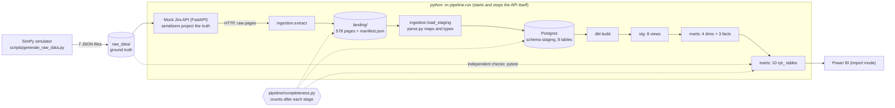

# Pipeline walkthrough: from the simulator to the Power BI report

An evidence-based map of how data flows through this repo. Every statement names the file (and line range where useful) it comes from. Anything I could not confirm from the code is marked **not verified** and collected at the end.

- Written on 2026-11-17, from the code at commit `6927d85` (branch `main`, working tree clean apart from an untracked `dashboard/AAP_dashboard.pbix`).
- Counts (3 teams, 530 issues, ...) are the shipped dataset, `SEED = 22` ([`simulator/clock.py:33`](../simulator/clock.py)).
- Related pages, not repeated here: [`etl/`](etl/README.md) (one page per stage), [`metrics/`](metrics/README.md) (one per business question), [`decisions.md`](decisions.md), [`domain-model.md`](domain-model.md), [`clean-run.md`](clean-run.md).

## 1. Entry point and orchestration

**Command:** `uv run --env-file .env python -m pipeline.run` ([`pipeline/run.py`](../pipeline/run.py), `main` at 224-249). Options: `--landing-dir` (default `landing/`) and `--dbt-project-dir` (default `dbt/`), used by the tests.

**Order of stages** (`run_pipeline`, `pipeline/run.py:192-221`):

1. **Preflight** (`preflight`, 137-177). Nothing is written before it passes. It checks, in this order: `AAP_API_BASE_URL` and `AAP_API_TOKEN`, the `POSTGRES_*` variables and a real connection, then prints `Target database: <db> on <host>:<port>` (read from the open connection, never the password). Then `raw_data/` has all 7 files, the API URL is a local `http://` URL, and the API port is free.
2. **Extraction.** Starts the mock API as a `uvicorn` subprocess (`pipeline/mock_api_server.py:68-83`), waits up to 15 s for an authenticated `GET /rest/agile/1.0/board?maxResults=1` to answer 200, runs `run_extraction`, stops the server. Then `completeness.check_landing`.
3. **Staging load.** `load_staging(conn, landing_dir)`, then `completeness.check_staging`.
4. **dbt build.** `dbt build --project-dir dbt --profiles-dir dbt` as a subprocess (`build_dbt`, 180-189), then `check_marts` and `check_reports`.

**It does not:** generate `raw_data/` (a precondition, exit 2 with the command to run), start Postgres, run pytest, or compare anything with `simulator/sprint_report.py`.

**Exit codes** (`pipeline/run.py:61-66`, docs in [`etl/05-pipeline.md`](etl/05-pipeline.md#schema-or-contract)):

| Code | Meaning |
|---|---|
| 0 | every stage and completeness check passed |
| 1 | a stage failed (`StageError`: any `Exception` inside a stage, wrapped by `stage()` at 124-134) |
| 2 | precondition failed, nothing written (`PreconditionError`) |
| 3 | a completeness check failed (`CompletenessError`, passes through `stage()` unwrapped) |
| 130 | Ctrl-C (`KeyboardInterrupt`) |
| 143 | SIGTERM: a handler raises `Terminated`, a `KeyboardInterrupt` subclass, so it takes the Ctrl-C cleanup path (`run.py:94-107`, installed at 229, restored at 248) |

**Failure handling.** `main` prints the stage and a "what is stale" message (`STALE_AFTER`) to stderr. Nothing is rolled back across stages. Each stage keeps its own guarantee: failed extraction keeps the previous `landing/`; a failed staging load rolls back (one transaction); a failed `dbt build` can leave `marts` mixed (models before the failure rebuilt, the failed model and everything downstream keep their previous tables). After exit 3 nothing is undone, so the data can be inspected. The mock API is stopped in every case, including exceptions, Ctrl-C and SIGTERM (`mock_api_server.py`, `finally: _stop(process)`: SIGTERM, then SIGKILL after 10 s). SIGKILL of the runner itself cannot be handled.

**Reset between runs.** There is no explicit clean-up step; each stage replaces its own output:

| Layer | What a rerun does | Where |
|---|---|---|
| `landing/` | Writes to `.landing.partial`, then swaps it in (`landing/` renamed to `.landing.previous`, scratch renamed to `landing/`, previous deleted). Replace, never append. | `ingestion/extract.py:109-162` |
| `staging` | `create schema if not exists`, create each table if missing (or check it matches its definition), `TRUNCATE` all, `COPY` in, one transaction. | `ingestion/load_staging.py:262-296` |
| `stg`, `marts` | `dbt build` recreates the 8 views and 17 tables. | `dbt/dbt_project.yml:27-36` |

**Can stages run alone?** Yes. Each has its own entry point: `python -m ingestion.extract` (needs a running API), `python -m ingestion.load_staging` (`--schema`, `--rebuild`), `dbt build`, `scripts/generate_raw_data.py`, `uvicorn mock_api.app:app`. `pipeline/completeness.py` has no command-line entry; it is only called by `run.py` and the tests.

## 2. Simulator output

- **Run:** `scripts/generate_raw_data.py` calls `run_simulation()` and `dump_to_json(collector, raw_data/)` (`scripts/generate_raw_data.py:46-50`). Entry in [`simulator/multi_team.py:125-190`](../simulator/multi_team.py).
- **Seed:** `SEED = 22` in `simulator/clock.py:33`. Each team's random stream comes from the seed and the team key (`team_rng(seed, personality.key)`, `multi_team.py:182`; `simulator/rng.py`), so one team's parameters can't change another's data. Calibration uses other seeds (1-60, held out 61-100, `simulator/calibration.py:31,41`).
- **Size:** 3 teams (`ALL_PERSONALITIES = (PHOENIX, ATLAS, NOMAD)`, `personalities.py:199`), 12 sprints each (`DEFAULT_NUM_SPRINTS = 12`, `multi_team.py:42`), project start 2024-01-08 09:00 (`clock.py`), one sprint of backlog warm-up (`sprint_cycle.py:63`) so Sprint 1 starts 2024-01-22.
- **Output:** one pretty-printed JSON array per entity in `raw_data/` (gitignored, regenerable): `teams.json`, `users.json`, `sprints.json`, `issues.json`, `status_transitions.json`, `sprint_issue_memberships.json`, `capacities.json` (`simulator/persistence.py:ENTITY_SPECS`, `dump_to_json` 211-232). Files in `raw_data/` on this machine: 3 teams, 12 users, 36 sprints, 530 issues (230 Story, 141 Bug, 129 Task, 30 Epic), 1,488 status transitions, 320 sprint memberships, 36 capacity rows. All 36 sprints are `closed`.
- **Shape:** the simulator's own ground-truth shape (readable string IDs like `PHX-S-1`), deliberately **not** Jira-shaped (`persistence.py` docstring). `Capacity` has `team_id, sprint_id, headcount, pto_days` (`simulator/capacity.py`).
- **Answer key:** `simulator/sprint_report.py:compute_sprint_report` derives committed, scope added, completed, hit, bug and issue counts per sprint from memberships and resolution dates. It stores nothing.

## 3. Mock API

File: [`mock_api/app.py`](../mock_api/app.py). The ground truth is loaded once at startup from `raw_data/` (or `$AAP_RAW_DATA_DIR`); the app refuses to start if a file is missing (`load_catalog`, ~179-195).

**Endpoints:**

| Endpoint | Line | Paging | Notes |
|---|---|---|---|
| `GET /rest/api/3/issue/{key}` | 334 | none | `fields`, `expand=changelog` (newest first, capped) |
| `GET /rest/api/3/issue/{key}/changelog` | 358 | `startAt`/`maxResults`, envelope with `isLast` | oldest first |
| `GET /rest/api/3/search/jql` | 368 | `nextPageToken` / `isLast`, no `total`, no `startAt` | needs a restricting `jql`; returns IDs only unless `fields` is given; max page 5000 |
| `GET /rest/agile/1.0/board` | 404 | agile envelope (`startAt`, `maxResults`, `total`, `isLast`, `values`), `agile_page` at 262 | one Scrum board per team |
| `GET /rest/agile/1.0/board/{id}/sprint` | 430 | agile envelope | |
| `GET /rest/agile/1.0/sprint/{id}` | 448 | none | |
| `GET /rest/agile/1.0/sprint/{id}/issue` | 453 | `startAt`/`maxResults`/`total` (no `isLast` in this one) | |
| `GET /capacity` | 488 | agile envelope | **ours, not Jira's** |

- **Auth:** every path except the docs paths needs `Authorization: Basic|Bearer <non-empty>`; any value is accepted (`app.py:297-307`). Errors use Jira's `{errorMessages, errors}` body.
- **Capacity vs. the Jira endpoints.** `/capacity` has its own snake_case row `{team_key, sprint_id, headcount, pto_days}` (`mock_api/capacity.py:21-42`), `pto_days` at full precision, filters `team` (project key) and `sprint` (agile sprint id). It shares only the auth rule, the error body and the agile paging envelope. Its team is a project key, not a project ID, which is why `fct_capacity` joins `dim_team` on `team_key`.
- **Renamed or hidden to mimic Jira** (`mock_api/serializers.py`, `config.py`, `ids.py`):
  - Story points are `fields.customfield_10016`, sprint membership is `fields.customfield_10020` (an array of sprint objects with `boardId`, a different shape from the agile sprint object) (`config.py`, `serializers.py:241-276`). Epics have `null` story points; the serializer raises if an Epic has any (`_story_points`, 197).
  - Statuses are a fixed map `To Do 10000`, `In Progress 10001`, `Code Review 10002`, `QA 10003`, `Done 10004` (`config.py`).
  - IDs are SHA-256 hashes of the ground-truth ID, so they are stable and never expose `PHX-I-1`-style IDs (`ids.py`). Users appear as 24-hex `accountId`.
  - Timestamps: platform API `...000+0000` (`jira_datetime`, `serializers.py:67`, which truncates microseconds to milliseconds), agile API `...000+00:00` (`agile_datetime`, 83; only its signature was checked, and sprint dates are whole seconds).
  - Sprint `startDate`/`endDate` are pinned to 09:00; `completeDate` is set equal to `endDate` for closed sprints (derived, not simulated) (`_sprint_dates`, 211-220). `goal` and `createdDate` are omitted. No `priority` field.
  - The ground truth has no board: the board is derived from the team (`serialize_board`, 425).
  - `parent` is omitted (not null) when there is none; `duedate` is a date string or `null`.

## 4. Extraction

Files: [`ingestion/client.py`](../ingestion/client.py), [`ingestion/extract.py`](../ingestion/extract.py).

- **Client.** `JiraClient` makes authenticated GETs (`Authorization: Bearer <AAP_API_TOKEN>`, 10 s timeout). It keeps each response body as the exact bytes received (`Page.body`) and decodes JSON only to follow paging. **It does no field mapping.**
- **Retry.** 3 attempts total, 0.5 s then 1 s backoff, on 5xx and transport errors only; any 4xx raises `ExtractionError` immediately (`client.py` `get`, `DEFAULT_ATTEMPTS = 3`).
- **Paging.** `offset_pages` follows `startAt`/`maxResults`, advancing by items actually returned, stopping on `isLast` or, when absent (sprint issue list), on `total`; it raises on a non-last empty page. `token_pages` follows `nextPageToken` until `isLast`.
- **Discovery order** (`extract.py:run_extraction`, 94-150): boards, then each board's sprints, then one JQL search per project key (`project = KEY ORDER BY created ASC`, `fields=*all`, because unbounded JQL is rejected), then each issue's changelog from the dedicated endpoint (not `expand=changelog`), each sprint's issue list, and `/capacity`.
- **Page sizes** (`PageSizes`, 56-64): boards 50, sprints 50, search 100, changelog 100, sprint issues 50, capacity 50.
- **Landing layout** (relative to `landing/`, gitignored): `boards/page-NNNN.json`, `board_sprints/<boardId>/page-NNNN.json`, `search/<KEY>/page-NNNN.json`, `changelogs/<issueKey>/page-NNNN.json`, `sprint_issues/<sprintId>/page-NNNN.json`, `capacity/page-NNNN.json`, plus `manifest.json` = `{"files": [{file, path, params}, ...]}` in request order. **One file per response page.** 578 pages + manifest = 579 files (checked on this machine: `landing/manifest.json` has 578 entries, `landing/` holds 579 files, and `landing/changelogs/` has 530 folders, one per issue).
- **Re-runs replace.** See the reset table in section 1. The extraction is byte-identical on rerun (tested, `tests/test_extraction.py`).
- **Where the Jira-to-clean-name mapping really lives:** in `ingestion/parse.py`, not in the client (section 5). `CLAUDE.md` says the "ingestion client maps them back"; the code does it in the parser, one stage later.

## 5. Landing to Postgres

File: [`ingestion/load_staging.py`](../ingestion/load_staging.py) with [`ingestion/parse.py`](../ingestion/parse.py).

- **Parsing** reads `landing/manifest.json`, never file names (`parse.read_landing`, 89-112). The request path decides what a page is (`ENDPOINTS`, `parse.py:26-33`).
  - **Timestamps:** both `+0000` and `+00:00` are parsed to UTC `timestamptz`; any other format raises (`parse_timestamp`, 115). `duedate` becomes a `date`.
  - **Status:** ID to name through the fixed map; the name is never taken from the payload, and a mismatch raises (`status_name`, 149).
  - **Story points:** `customfield_10016` becomes `story_points` (`parse_issues`, 283-383).
  - **Transitions** come from changelog items with `field = "status"`; **memberships** from items with `fieldId = "customfield_10020"`: each sprint ID in `to` but not in `from` is one row, with `added_at` = the history's `created`. An issue *removed* from a sprint raises `ParseError` (v1 models additions only).
  - **Users** are deduplicated `accountId`s seen as assignee, reporter or changelog author. **Teams** come from board `location` and issue `project`.
  - The `sprint_issues` pages are **landed but not loaded**: they only feed the completeness check and tests.
- **Load:** `psycopg` 3, one transaction, `create schema if not exists staging`, create-or-check each table, `TRUNCATE` all, `COPY` each (`load_staging`, 262-296). **Full refresh, never incremental.** `--rebuild` drops and recreates (no CASCADE) for a schema change. Connection from `POSTGRES_*` only (`connect_from_environment`, 160-185); the loader does not read `.env` itself.
- **Schema and tables** (`TABLES`, `load_staging.py:86-~150`), schema `staging`. Every table also has `_source_file text not null` and `_loaded_at timestamptz not null`.

| Table | Primary key | Types |
|---|---|---|
| `teams` | `project_id` | bigint, text, text |
| `users` | `account_id` | text, text |
| `boards` | `board_id` | bigint, text, text, bigint, text |
| `sprints` | `sprint_id` | bigint ids, text, `start_at`/`end_at`/`complete_at` timestamptz (nullable) |
| `capacity` | `team_key, sprint_id` | text, bigint, `headcount` integer, `pto_days` double precision |
| `issues` | `issue_id` (+ unique `issue_key`) | bigint ids, `story_points` numeric (null for Epics), `created_at`/`resolved_at` timestamptz, `duedate` date |
| `status_transitions` | `changelog_id` | bigint ids, `transitioned_at` timestamptz, status ids bigint, names text |
| `sprint_memberships` | `issue_id, sprint_id` | bigint, bigint, `added_at` timestamptz, bigint |

No foreign keys (D-019): relationships are checked by dbt tests.

## 6. dbt staging

Project `dbt/` (dbt Core 1.12.6 per `dbt/target/manifest.json`, profile `aap`, credentials from `POSTGRES_*` via `env_var()` in `dbt/profiles.yml`). The `stg` folder is `+schema: stg`, `+materialized: view` (`dbt_project.yml:27-29`); `generate_schema_name` is overridden so schemas are exactly `stg` and `marts` (`dbt/macros/generate_schema_name.sql`). Sources are the 8 staging tables (`models/staging/_staging__sources.yml`). **All 8 are views, 1:1 with a staging table; they only rename and select.**

| Model | Renames |
|---|---|
| `stg_teams` | `project_id`→`team_id`, `project_key`→`team_key`, `project_name`→`team_name` |
| `stg_users` | `account_id`→`user_id` |
| `stg_boards` | `project_id`→`team_id`, `project_key`→`team_key` |
| `stg_sprints` | `state`→`sprint_state` |
| `stg_capacity` | none (keeps `team_key`) |
| `stg_issues` | `project_id`→`team_id`, `assignee_account_id`→`assignee_user_id`, `reporter_account_id`→`reporter_user_id` |
| `stg_status_transitions` | `author_account_id`→`author_user_id` |
| `stg_sprint_memberships` | none |

All keep `_source_file` and `_loaded_at`. No cleaning, filtering or business logic.

## 7. dbt marts

Both `marts/` (star schema) and `metrics/` (`rpt_`) are `+schema: marts`, `+materialized: table` (`dbt_project.yml:30-36`). Verified per model from `dbt/target/manifest.json`: 17 tables, 8 views. Metrics are computed in SQL in the `rpt_` models, not in Power BI (D-033).

### Dimensions and facts (natural keys, no surrogate keys, no date dimension: D-028)

| Model | Grain (one row per) | Key | Notes |
|---|---|---|---|
| `dim_team` | team | `team_id` (`team_key` unique) | |
| `dim_user` | user | `user_id` | `team_id` derived from the teams of the issues assigned to the user; null unless exactly one team (D-029), and a `not_null` test then fails |
| `dim_sprint` | sprint | `sprint_id` | team via the board (`left join stg_boards`); `start_at`, `end_at` are the 09:00 UTC instants |
| `dim_issue` | issue | `issue_id` | current status only; Epics keep null points |
| `fct_status_transitions` | status change | `changelog_id` | `event_sprint_id` = the sprint of the issue's team whose half-open window `[start_at, end_at)` contains the transition (D-030) |
| `fct_sprint_membership` | issue joining a sprint | `issue_id, sprint_id` | `added_at` |
| `fct_capacity` | team and sprint | `team_id, sprint_id` | `team_id` looked up from `team_key` |

### `rpt_` tables (the ones the dashboard reads)

| Table | Grain | Key columns | Rows |
|---|---|---|---|
| `rpt_sprint_metrics` | sprint | `sprint_id` | 36 |
| `rpt_data_as_of` | whole dataset | none | 1 |
| `rpt_q1_velocity` | sprint | `sprint_id` | 36 |
| `rpt_q2_velocity_vs_capacity` | sprint | `sprint_id` | 36 |
| `rpt_q3_deadline_outcomes` | issue with a due date | `issue_id` | 320 |
| `rpt_q3_breach_rate` | team × issue type × commitment, with rollups | `team_name, issue_type, commitment` | 48 |
| `rpt_q4_status_stays` | stay of a non-Epic issue in a status | `issue_id, stay_number` | 1,988 |
| `rpt_q4_time_in_status` | team × status, with "All teams" rows | `team_name, status_name` | 16 |
| `rpt_q5_bug_to_story_ratio` | team × period (12 sprint windows + period 0 "Before Sprint 1") | `team_id, period_number` | 39 |
| `rpt_q6_team_portfolio` | team | `team_id` | 3 |

Row counts are from [`etl/04-metrics.md`](etl/04-metrics.md#business-question-models) and `pipeline/completeness.py`; `pipeline.run` checks them against the upstream tables on every run.

**`rpt_sprint_metrics`** (`dbt/models/metrics/rpt_sprint_metrics.sql`). Members of a sprint come from `fct_sprint_membership` joined to `dim_issue`. Per sprint:
- `committed_points` = sum of story points of members with `added_at <= sprint start_at`.
- `scope_added_points` = members with `added_at > start_at`.
- `completed_points` = members with `resolved_at <= end_at`, **whether committed or added**.
- `is_hit` = `completed_points >= committed_points`. There is no sprint-goal field anywhere in the data; "goal hit" in the dashboard means this.
- `bug_count`, `issue_count` over members; `sprint_number` = position by `start_at` within the team.
- Exact instants, never calendar days (D-012). `complete_at` is not used (it is derived from `end_at`, D-032).

**Late work.** Two different things, both in the models:
- *Points finished after the sprint ended:* `rpt_q1_velocity.completed_after_end_points` / `_issues` = members with `resolved_at > end_at` (no carryover in v1, so these count in no sprint's velocity).
- *Issue past its due date:* `rpt_q3_deadline_outcomes.outcome` = `late` when the UTC date of `resolved_at` is later than `duedate`; `on_time` otherwise; unresolved issues are `open_overdue` (due before the as-of date) or `open_not_due`. The as-of instant is the latest event in the data (`rpt_data_as_of`, D-036), never wall-clock time.

**`is_rollup`** (added in step 5.3, D-047):
- `rpt_q3_breach_rate` is built with `group by cube ((team_name, team_key), issue_type, commitment)` (`rpt_q3_breach_rate.sql:27`). Rollup rows are labelled `team_name = 'All teams'` / `team_key = 'ALL'`, `issue_type = 'All types'`, `commitment = 'All'`. `is_rollup = grouping(team_name, issue_type, commitment) > 0`: **true on every row where any of the three is rolled up**. 18 detail rows (3 teams × 3 types × 2 commitments) and 30 rollup rows. `is_rollup = false` rows add up to the 320 issues with a due date; summing across rollup levels double-counts.
- `rpt_q4_time_in_status` uses `group by grouping sets ((team_name, team_key, status_name, status_order), (status_name, status_order))`; `is_rollup = grouping(team_name) = 1`. 12 team rows (3 teams × 4 statuses) and 4 "All teams" rows.
- Rates (`breach_rate_resolved`, `breach_rate_incl_overdue`) are ratios of counts on each row; they must never be summed or averaged across rows. Only these two tables mix totals with detail rows (the other eight do not). `rpt_q6_team_portfolio` reads rollup tables with `team_key <> 'ALL'` filters.
- The check that the flag matches the labels: `dbt/tests/assert_rollup_flag_matches_labels.sql`.

**Other definitions:**
- *Q1* `rpt_q1_velocity`: velocity = `completed_points`; `velocity_rolling_3` = average over the sprint and the two before it in the same team; `sprints_in_window` says how many sprints the window held.
- *Q2* `rpt_q2_velocity_vs_capacity`: `available_person_days = headcount × 10 − pto_days` (var `sprint_working_days = 10`, `dbt_project.yml:21`, D-037); `points_per_person_day = completed_points / available_person_days`; the rolling figure is capacity-weighted (summed points over summed person-days).
- *Q4* `rpt_q4_status_stays` / `rpt_q4_time_in_status`: durations in calendar hours; Epics excluded; mean, median, p90 over completed stays only; still-open stays are counted with their median age, never mixed in (D-040).
- *Q5* `rpt_q5_bug_to_story_ratio`: counts issues by the sprint window they were created in; period 0 has `sprint_id` null.
- *Q6* `rpt_q6_team_portfolio`: reads Q1 to Q5 and `rpt_sprint_metrics`; recomputes nothing (D-042).

## 8. Data quality

**dbt: 229 data tests** (`PASS=254` in `dbt build` = 8 views + 17 tables + 229 tests). Breakdown from `dbt/target/manifest.json` (generated 2026-11-14): 154 `not_null`, 13 `unique`, 16 `relationships`, 12 `accepted_values`, 16 `expected_row_count`, 6 `unique_combination`, and **12 singular tests** in `dbt/tests/`: breach-rollups add up, each transition in exactly one sprint window, each user assigned in one team, fact teams match their sprint, PTO within person-days, Q5 counts every created issue, rollup flag matches labels, sprint metrics cover every membership, sprint number matches name, status stays chain without gaps, story points null exactly for Epics, transitions join every dimension once. The `expected_row_count` tests **hardcode the SEED=22 counts** (`dbt/tests/generic/expected_row_count.sql`, e.g. `expected: 36` in `_metrics__sprint.yml`).

**pytest: 140 tests** (from `pytest --co`): extraction 18, staging 33, staging reconciliation 10, dbt 19, metrics 26, mock API verify 4, pipeline 30. They use the real `raw_data/`, build into throwaway schemas (`staging_test`, `stg_test`, `marts_test`) or databases (`aap_pipeline_test`, `aap_test_shared`), and never touch the real schemas. Many checks have a paired `test_sabotage_*` test that breaks one thing on purpose and asserts the right check fails; I did not audit that every check has one.
- `test_staging_reconciliation.py`: all 8 staging tables equal `raw_data/` row by row (the test reads the JSON directly, imports nothing from `mock_api/`).
- `test_metrics.py`: the sprint metrics equal the answer key, and Q1 to Q5 are recomputed in plain Python from `raw_data/` and compared; Q6 must equal Q1 to Q5 team by team.
- `test_pipeline.py`: a real run from an empty database, one row lost at each stage boundary (exit 3), exit codes, mock API cleanup, SIGTERM, the target line.
- `tests/test_mock_api_verify.py` wraps `mock_api.verify` and `mock_api.verify_app`.

**Runtime checks inside `pipeline.run`** (`pipeline/completeness.py`): counts only, between adjacent stages, with no hardcoded dataset numbers: manifest vs. files on disk; landed records vs. staging rows; each dim/fact vs. its staging table (`MARTS_FROM_STAGING`, 31-39); each `rpt_` table vs. the table it is built from (e.g. `rpt_sprint_metrics` rows = `dim_sprint` rows). They do **not** compare values.

**Is there a check that produces "36 of 36 team-sprints reconciled"?**
- **The reconciliation exists, but it only runs under pytest.** `tests/test_metrics.py::test_sprint_metrics_match_sprint_report_for_every_sprint` (line 174) builds the answer key with `compute_sprint_report` on `raw_data/`, reads `rpt_sprint_metrics`, asserts `len(actual) == 36` and `differences(expected, actual) == {}` over six values (committed, scope added, completed, hit, bug count, issue count). It **prints no "36 of 36" line**; it passes or fails.
- **`pipeline.run` does not run it.** Its only "36" is the count equality `rpt_sprint_metrics` = `dim_sprint` = 36.
- **The words "36 of 36 ... reconciled" appear only inside the Power BI file** (`dashboard/AAP_dashboard.pbix`, untracked): the `data` page's footer text box (`Refreshed by pipeline.run · 36 of 36 sprints reconciled`) and the "Definition of done" text box (`36 of 36 team-sprints reconciled with the source`, `229 dbt data tests pass`, `140 Python tests pass`, `48 modelling decisions logged`). In the report definition these are **static text runs, not DAX measures or queries**; no code in the repo emits or refreshes them (grepping the `.py`, `.sql` and `.yml` files for "reconciled" finds nothing; the word appears only in prose in the docs, `README.md` and `CLAUDE.md`). They are true today (the test passes, 229 and 140 match, D-001 to D-048 is 48 entries), but they will not change if the data does.

## 9. Power BI contract

- **Database:** PostgreSQL 18.6 in Docker (`warehouse/docker-compose.yml:15`), published on `127.0.0.1:${POSTGRES_PORT:-5433}` only (`:25`). Defaults from `.env.example`: host `localhost`, port `5433`, database `aap_warehouse`, user `aap`.
- **Credentials mechanism:** `POSTGRES_USER`, `POSTGRES_PASSWORD`, `POSTGRES_DB`, `POSTGRES_HOST`, `POSTGRES_PORT` in the gitignored `.env` (copied from `.env.example`, which holds a placeholder). Nothing in the repo stores a Power BI connection; Power BI needs the same host, port, database, user and password typed into its PostgreSQL connector. I did not read the password.
- **Schema:** `marts`. The `stg` views and `staging` tables are plumbing and need not be imported.
- **Tables to import:** the ten `marts.rpt_*` tables, plus `marts.dim_team` for a team slicer. The existing report (`dashboard/AAP_dashboard.pbix`; its own pipeline-diagram text says "import mode", the actual storage mode is not verified) references these tables, which Power BI names with the schema prefix (`marts rpt_q1_velocity` etc.): `dim_team`, `rpt_data_as_of`, `rpt_q1_velocity`, `rpt_q2_velocity_vs_capacity`, `rpt_q3_breach_rate`, `rpt_q4_time_in_status`, `rpt_q5_bug_to_story_ratio`, `rpt_q6_team_portfolio`, `rpt_sprint_metrics`. Five pages: Health, Delivery & capacity, Predictability, Flow & quality, About the data. Its measures (DAX) live in the compressed data model, which I did not open.
- **Contract rules for any visual:**
  - Every `rpt_` table already carries team and sprint names, so no joins are needed (D-033). Renaming a model is a breaking change.
  - `rpt_q3_breach_rate` and `rpt_q4_time_in_status`: filter `is_rollup = false` before summing counts, or `is_rollup = true` for an all-teams figure. Never sum or average a rate across rows. Power BI normally sums numeric columns by default (general tool behaviour, not something in this repo), so set the aggregation to "Don't summarize" for rates.
  - `rpt_q5_bug_to_story_ratio`: `period_number = 0` is "Before Sprint 1" (null `sprint_id`).
  - `rpt_q4_time_in_status` has rows for 4 working statuses only (no Done).
  - Rates are fractions 0 to 1, null when the denominator is 0. Timestamps are `timestamptz` in UTC.
- **Refresh:** only after `pipeline.run` exits 0; after a failed `dbt build` the `marts` tables may be a mix of old and new.

## 10. Known gaps

Things I found that are surprising, brittle or inconsistent with the docs.

1. **Static "reconciled" claims in the dashboard** (section 8). The footer and the definition of done are typed text, not computed from the warehouse, and `pipeline.run` does not run the reconciliation they describe.
2. **`dbt build` is tied to SEED=22.** The 16 `expected_row_count` tests hardcode the shipped counts, while `pipeline/completeness.py` is seed-agnostic. A different seed makes `pipeline.run` fail at `dbt build` (exit 1), not at a completeness check.
3. **`CLAUDE.md` says the ingestion client maps Jira's custom fields.** The client returns raw bytes; the mapping (`customfield_10016`, `customfield_10020`, status IDs) is in `ingestion/parse.py`.
4. **Sprint-issue pages are extracted and landed but never loaded** into staging. Memberships come from the changelog only; the sprint-issue lists are only used as an independent check.
5. **`self` URLs in API payloads always say `http://localhost:8000`** (`mock_api/config.py:20`), whatever port the app serves on. Nothing in the pipeline follows them.
6. **README says `dashboard/` is "(empty), planned, not started"**, but `dashboard/AAP_dashboard.pbix` exists (untracked: it is neither committed nor gitignored). `CLAUDE.md` also lists the dashboard as "later".
7. **"Sprint goal hit" has no sprint goal behind it.** `is_hit` is `completed >= committed`, and `completed` includes scope-added points, so a sprint can be a hit with committed work unfinished (documented in `sprint_report.py` and `domain-model.md`).
8. **No carryover:** unfinished work stays in its original sprint, so 343 points never count in any sprint's velocity (documented, `etl/04-metrics.md`). The dashboard's "late work share" is the visible effect.
9. **The sentinel `'ALL'`** in `team_key` marks rollup rows in Q3 and Q4, and `rpt_q6_team_portfolio` filters on it. Tolerable, but a real team key `ALL` would collide.
10. **`dim_user.team_id` is null** for a user assigned no issues or issues in two teams; the test suite reports it instead of choosing (D-029).
11. **`docs/decision-log.md`** names `/rest/api/2/search` and a "to be decided" data model. It is marked superseded, and the code uses `/rest/api/3/search/jql` and the final star schema (`decisions.md`).
12. **Stale `.env` risk:** exported `POSTGRES_*` variables override `.env` and `--env-file`. The target line printed by `pipeline.run` shows which database it will use, but the run does not pause (D-048).
13. **`complete_at` is derived** (`end_at` for closed sprints), so its reconciliation proves only the derivation rule; no metric uses it (D-032).

## Not verified

- **Live database contents.** The Postgres container was stopped when I looked (`docker exec` said "not running"), and I did not start it. Materializations and row counts come from the code, the docs and `dbt/target/manifest.json` (generated 2026-11-14), not from a query. Exact column types of the `marts` tables are not checked; the staging types are from `load_staging.py`.
- **Power BI internals.** The DAX measures, the table relationships and the connection settings (server, database, credential mode) are inside the compressed `DataModel` of the `.pbix`, which I did not open. Which tables are imported is inferred from the visuals' field references. Whether Power BI Desktop on Windows reaches `localhost:5433` from WSL2 is not tested.
- **The report's storage mode** (import vs. DirectQuery); only its own text says "import mode".
- **How the dashboard computes** "Late share", "Rework per 100" and "Goal Hit Rate": only their text descriptions were read.
- **A run on another seed.** My claim that it fails at `dbt build` follows from the hardcoded tests; I did not run it.
- **Timings and the 25-second setup figure** were not re-measured today; they come from [`clean-run.md`](clean-run.md).
- **Whether `landing/` and `raw_data/` on this machine are current** with the code at `6927d85` (counts match the documented numbers).
- **Mock API behaviour beyond the code read:** JQL subset details (`mock_api/jql.py`) and the `expand=changelog` cap were not read in full.
- **Line numbers** marked with `~` are approximate; the others were read directly.
